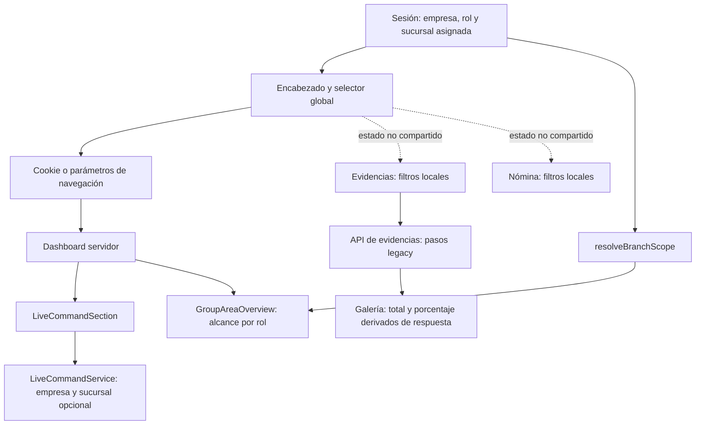

# Auditoría funcional del frontend del demo

Fecha: 29 de octubre de 2026. Entorno: https://pulso-horeca.netlify.app.

**Resultado:** el demo carga y permite recorrer sus módulos, pero hay fallos de alcance por sucursal, contratos de datos y estados de negocio. Volver a ejecutar el seed no resuelve estos problemas de lectura y presentación.

## Alcance y método

Auditoría realizada con **Chrome DevTools MCP** sobre el sitio publicado: DOM y árbol de accesibilidad, interacciones reales, red, consola, emulación móvil, Lighthouse snapshot y una traza de rendimiento. Se contrastaron los comportamientos con el código del workspace usando CodeGraph y lecturas dirigidas.

Se recorrieron login, dashboard, inventario, formulario de conteo, evidencias, finanzas, nómina/aguinaldo e historial de workflows. Se probaron dos sesiones aisladas: Carlos (SUPER_ADMIN) y Juan (GERENTE asignado a Condesa). Escritorio y nómina en móvil de 390 × 844; zona horaria del navegador America/Mexico_City.

Solo se inició sesión, navegó, modificó filtros y abrió detalles. No se ejecutaron nóminas, timbrados, recuperaciones, envíos ni cambios operativos. No se modificó código de la aplicación durante esta auditoría.

Las causas identificadas corresponden al código local; no se verificó que el despliegue tenga exactamente el mismo commit. Los resultados visibles y respuestas de red sí se reprodujeron en el sitio publicado. Los totales canónicos del seed provienen de la [verificación anterior](../seed-demo-2026-10-29/README.md), no de una nueva auditoría integral de la base.

Prioridades: **P1** corregir primero por exposición de datos o información financiera incorrecta; **P2** lógica funcional y confiabilidad del demo; **P3** presentación y observaciones de rendimiento.

**Informe complementario:** la segunda pasada del mismo día, centrada en schedules, permisos por rol y estados de nómina, está en [auditoria-produccion-2026-10-29.md](auditoria-produccion-2026-10-29.md).

## Resumen de hallazgos

| ID | Prioridad | Hallazgo | Capa implicada |
|---|---|---|---|
| F01 | P1 | Un gerente asignado a Condesa puede ver el pulso de otras sucursales | Autorización del render servidor |
| F02 | P1 | Nómina muestra fechas un día antes que la API | Formato de fechas civiles |
| F03 | P2 | El filtro global de sucursal no gobierna evidencias y nómina | Estado y consultas del frontend |
| F04 | P2 | El filtro “Ayer” deja el pulso mostrando hoy | Contrato temporal del dashboard |
| F05 | P2 | Evidencias presenta un subconjunto de 8 como total | Consulta, paginación y modelo de datos |
| F06 | P2 | “Verificadas IA” incluye evidencias sin verificar | Contrato frontend/API |
| F07 | P2 | La galería muestra porcentajes IA de hasta 9900% | Contrato seed/API |
| F08 | P2 | Las ocho imágenes de la galería fallan | Assets de demostración |
| F09 | P2 | “Aperturas a tiempo 100%” contradice las filas con retraso | Definición del KPI |
| F10 | P2 | Alto valor dice “Sin contar aún” pese a los conteos del seed | Lectura de modelo anterior |
| F11 | P2 | El modal llama timbrados a recibos pendientes | Estado fiscal y presentación |
| F12 | P3 | Historial muestra claves de traducción y errores de i18n | Catálogo de mensajes |
| F13 | P3 | Desplazamiento visual medido de 0.19 en una carga | Rendimiento; requiere seguimiento |

## Lógica observada

El selector de sucursal del encabezado y las consultas de cada módulo no comparten una única resolución efectiva. Algunos widgets resuelven el rol en servidor; otros reciben directamente cookie/query; otros mantienen filtros locales independientes.

La consecuencia es una misma pantalla con encabezado, indicadores y listados que pueden representar ámbitos distintos. Inventario y el historial sí reflejaron Roma tras completar la navegación; el selector global no falla de forma uniforme.

## F01 — Alcance de gerente omitido en el pulso

**Reproducción:** iniciar como Juan y abrir /dashboard. El encabezado indica Condesa y explica que el usuario está asignado a esa sucursal. El pulso muestra las tres sucursales, ventas de $49,490 y alertas de otras sucursales. Persistió tras recargar.

Al abrir /dashboard?branch=b1000001-0000-4000-8000-000000000003, el pulso muestra Roma y $15,670, mientras el encabezado continúa en Condesa y las tarjetas de GroupAreaOverview conservan el alcance Condesa.

**Impacto:** exposición entre sucursales dentro de la misma empresa y decisiones basadas en un ámbito distinto al autorizado. No se probó ni se afirma acceso entre empresas.

**Causa local:** app/dashboard/page.tsx:24 toma cookieBranch || params.branch; en :42 lo pasa al pulso. LiveCommandService filtra empresa y sucursal opcional sin resolver la sucursal asignada del rol. GroupAreaOverview sí utiliza resolveBranchScope en :69, lo que explica la mezcla.

**Corrección y aceptación:** resolver el alcance autorizado una vez en servidor y compartirlo entre widgets. Un gerente debe recibir únicamente Condesa tanto sin filtros como ante query/cookie de Roma; comprobar encabezado, ventas, alertas, matriz y actividad reciente.

Evidencia: [sesión gerente](04-gerente-dashboard.txt), [override Roma](05-gerente-roma.txt).

## F02 — Fechas civiles desplazadas en nómina

**Observado:** la API entrega período ordinario 2026-10-22 a 2026-10-28; el historial y modal muestran **21 oct–27 oct 2026**. El período anual también se desplaza al usar ese formateador. La tarjeta específica de aguinaldo muestra las fechas ISO correctas, creando otra contradicción.

**Causa local:** app/dashboard/labor/payroll/page.tsx:531–532 convierte YYYY-MM-DD mediante new Date y luego formatea en hora local. La conversión interpreta medianoche UTC y en México cae en el día previo.

**Corrección y aceptación:** tratar períodos como fechas civiles con un helper compartido; probar México y UTC, incluidos 1 de enero y 31 de diciembre. Historial, modal y aguinaldo deben conservar los mismos días de la API.

Evidencia: [respuesta API](api-nomina.txt), [pantalla](08-nomina.txt), [modal](09-recibos-pendientes.txt).

## F03 — Filtros de sucursal independientes y ambiguos

Con el encabezado en **Roma**, Evidencias mantiene su selector en “Todas las sucursales” y muestra Condesa/Polanco. La solicitud no incluye branchId. Nómina y aguinaldo también conservan selectores locales “Todas” con información de toda la empresa.

**Causa local:** EvidencePage inicializa filters con objeto vacío (:85) y solo agrega la sucursal local (:124). Nómina inicializa selectedBranch en “all” (:78). El encabezado no determina esas consultas.

**Corrección y aceptación:** definir si el selector global gobierna estos módulos. Si es global, sincronizarlo con las consultas y limpiar estados dependientes; si existen ámbitos distintos, mostrarlos explícitamente junto a cada resultado. Encabezado Roma y listados Condesa no deben aparentar el mismo ámbito.

Evidencia: [galería](07-evidencias-roma.txt), [nómina](08-nomina.txt). En inventario e historial sí se observó Roma: [inventario](06-inventario-roma.txt), [historial](10-historial.txt).

## F04 — “Ayer” no cambia el pulso

Al seleccionar Ayer, la URL contiene startDate=2026-10-28&endDate=2026-10-28, pero el pulso conserva la fecha operativa 29 de octubre y las ventas Roma de $15,670.

**Causa local:** DashboardPage declara startDate/endDate, pero no los entrega a LiveCommandSection. El servicio calcula el pulso de hoy.

**Corrección y aceptación:** aplicar las fechas cuando corresponda a información histórica; si el pulso es siempre en vivo, explicarlo y delimitar qué paneles afecta el selector. No presentar un selector como control de un resultado que lo ignora.

Evidencia: [Ayer](03-dashboard-ayer.txt), [Roma](02-dashboard-roma.txt).

## F05 — Galería truncada con total engañoso

La galería sin filtros muestra **TOTAL REGISTROS 8**, sin paginación. El seed verificado previamente tiene 1312 registros de evidencia canónica. Son modelos distintos; no se espera renderizar los 1312 juntos, pero el número 8 no representa su total.

**Causa local:** app/api/workflows/evidence/route.ts:128 limita primero a 200 pasos; :131 descarta después los que no contienen evidenceUrl. Además, consulta pasos legacy en lugar del registro canónico. El cliente cuenta evidences.length (:241) como total.

**Corrección y aceptación:** elegir el modelo de evidencia vigente, filtrar antes de paginar y devolver total/cursor explícitos. Probar evidencia antigua fuera de los últimos 200 pasos y reconciliar los registros visibles con el modelo canónico. Distinguir “resultados de esta página” de “total”.

Evidencia: [galería](07-evidencias-roma.txt) y [verificación del seed](../seed-demo-2026-10-29/verificacion-final.json).

## F06 — Filtro IA ignorado por el servidor

Seleccionar “Verificadas IA” genera GET /api/workflows/evidence?verified=true. La respuesta sigue conteniendo ocho elementos, cinco con aiVerified=false; la pantalla conserva cinco estados “Revisión”.

**Causa local:** el cliente envía verified (:123), pero la ruta solo lee branchId, dateFrom, dateTo y search (:49–53). Tampoco procesa el parámetro type enviado por el cliente.

**Corrección y aceptación:** aplicar filtros en servidor antes de contar/paginar; probar true, false y combinado con sucursal/fecha. Todos los registros bajo “Verificadas” deben cumplir el estado seleccionado. El filtro type se detectó en código; no se reprodujo por separado.

Evidencia: [pantalla filtrada](11-evidencias-verificadas.txt), [respuesta filtrada](api-evidencias-verificadas.txt).

## F07 — Escala IA incompatible

La galería muestra 9900%, 9700% y 8800%. Estos valores ya vienen así en la API.

**Causa local:** scripts/seed-05-workflows.ts:291–299 escribe confidence en escala 60–100, mientras app/api/workflows/evidence/route.ts:153 multiplica confidence por 100 esperando 0–1. La UI imprime el resultado como porcentaje.

**Corrección y aceptación:** establecer una unidad contractual y validar el rango al generar y leer datos. Definir tratamiento explícito de datos legacy; probar confianza fraccional y el formato histórico. No ocultar el problema solamente con un límite visual.

Evidencia: [galería](07-evidencias-roma.txt), [respuesta](api-evidencias-verificadas.txt).

## F08 — Assets ficticios de evidencia

Las ocho tarjetas muestran “Imagen no disponible”. Las solicitudes a /_next/image con origen https://pulso.ejemplo/evidencia/...jpg devuelven HTTP 400.

**Causa:** el seed referencia un dominio de ejemplo; crear registros/backfill no crea esos archivos. Esto es una limitación de los assets del demo, no prueba pérdida de archivos reales.

**Corrección y aceptación:** suministrar imágenes de demostración existentes en assets locales o almacenamiento válido y verificar su autorización/configuración de imágenes. Las miniaturas y detalle deben cargar; no quitar validaciones del optimizador para aceptar URLs ficticias.

Evidencia visual textual: [galería](07-evidencias-roma.txt); errores HTTP: [consola](consola.txt). Las URLs de las respuestas permiten identificar los assets.

## F09 — KPI de apertura semánticamente incorrecto

La vista de red muestra **Aperturas a Tiempo 100%, 3 de 3**, mientras la matriz marca retraso en las sucursales y “Abrió tarde (20:00 hrs)”.

**Causa local:** LiveCommandService:307–309 cuenta cualquier actividad como apertura; :411 calcula openCount/totalBranches. Esa proporción se rotula “a tiempo”, aunque la clasificación de retraso se calcula por separado con getHours y un umbral fijo.

**Corrección y aceptación:** separar sucursales abiertas de aperturas puntuales. Usar una fuente de apertura y horario/zona de sucursal coherentes en resumen y detalle. Con tres aperturas tardías, el porcentaje puntual no puede ser 100%. Revisar además la fecha/hora de las actividades sintéticas.

Evidencia: [dashboard de gerente con red completa](04-gerente-dashboard.txt).

## F10 — Conteos existentes no reflejados en alto valor

Inventario Roma muestra los siete artículos de alto valor como “Sin contar aún”; la API devuelve lastCountedAt=null para todos. El seed anterior sí creó conteos canónicos por sucursal.

**Causa local:** app/api/inventory/high-value/route.ts busca workflows completados del template STOCK_COUNT_TEMPLATE_NAME y pasos count-*, en lugar de consumir el registro canónico stockCounts que alimenta otros cálculos. La UI refleja fielmente ese resultado nulo.

**Corrección y aceptación:** unificar la fuente de última fecha de conteo con el servicio vigente. Un conteo canónico completado debe actualizar tanto el resumen como los artículos afectados; conservar “Sin contar” para artículos realmente no contados.

Evidencia: [inventario](06-inventario-roma.txt), [respuesta](api-inventario-alto-valor.txt), [verificación anterior](../seed-demo-2026-10-29/README.md).

## F11 — Recibos pendientes rotulados como timbrados

La corrida está en DRAFT y sus tres recibos aparecen PENDIENTE sin UUID, pero el modal dice **“Recibos de Nómina Timbrados”**.

**Causa local:** encabezado fijo en app/dashboard/labor/payroll/page.tsx:578; la vista mezcla estado de corrida con estado fiscal.

**Corrección y aceptación:** título neutral o derivado del estado; diferenciar borrador, pendiente, timbrado y error. Un recibo sin timbre no debe rotularse timbrado.

**Observación adicional del flujo:** con fechas vacías y sin validación previa, “2. Ejecutar y Timbrar Nómina” aparece habilitado. La condición local en :480 permite validationData=null. No se pulsó: esto no demuestra que el backend permita timbrar sin validación. Conviene exigir validación vigente en UI e invalidarla cuando cambien los datos.

Evidencia: [modal](09-recibos-pendientes.txt), [nómina](08-nomina.txt).

## F12 — Mensajes sin traducir en historial

El encabezado de columna muestra common.workflow. Al buscar una cadena sin coincidencias, el estado vacío muestra workflows.history.noWorkflowsFound. La consola registra MISSING_MESSAGE de common.workflow y workflows.history.status.blocked (es).

**Corrección y aceptación:** completar el catálogo español y probar tabla, vacío y estados bloqueados. La búsqueda sí produjo cero resultados; el fallo observado es el texto de presentación.

Evidencia: [tabla](10-historial.txt), [vacío](12-historial-busqueda.txt), [consola](consola.txt).

## F13 — Rendimiento y estabilidad visual

Una recarga instrumentada del dashboard de gerente con Roma, sin throttling de CPU/red, dio:

| Métrica | Medición |
|---|---:|
| LCP | 2081 ms |
| TTFB | 1559 ms |
| CLS | 0.19 |

El análisis CLS ubica un desplazamiento del elemento MAIN alrededor de 3.32 s, sin atribuir una causa específica. No se concluye que sidebar o skeleton sean la causa; deben investigarse comparando sus dimensiones y el momento de hidratación. Es una medición de laboratorio, no percentiles de usuarios ni un presupuesto validado en distintas redes.

Evidencia: [traza resumida](rendimiento.txt), [análisis CLS](cls.txt).

## Comprobaciones satisfactorias y límites

- Login y navegación de ambos roles funcionaron.
- Cambiar a Roma actualizó inventario e historial después de completarse la navegación; se descartaron snapshots transitorios como hallazgos.
- La búsqueda del historial actualizó la URL y mostró cero resultados para una cadena inexistente.
- Aguinaldo mantuvo el bloqueo de Luisa y el control de ejecución deshabilitado correspondiente.
- En nómina móvil no se detectó desbordamiento horizontal del documento (ancho 390 px).
- Lighthouse en modo **snapshot**, únicamente sobre el dashboard inspeccionado, devolvió 100 en accesibilidad, buenas prácticas, SEO y Agentic, con 37 comprobaciones aprobadas. No equivale a una auditoría WCAG integral ni a resultados de todo el producto; ese modo tampoco mide rendimiento. [Salida](lighthouse.txt).
- Se inspeccionaron capturas visuales durante la sesión; los archivos conservados aquí son snapshots textuales y salidas de herramientas. La herramienta no permitió persistir sus capturas directamente en esta ruta.
- No se auditó cada ruta, todos los roles, exportaciones, mutaciones, lector de pantalla ni el ciclo fiscal completo. No se ejecutaron tests/build porque no se implementaron cambios de aplicación.

## Orden de corrección propuesto

1. F01: resolver autorización efectiva de sucursal en servidor.
2. F02: corregir fechas civiles en toda la nómina.
3. F03–F06: unificar filtros, fuentes y paginación; hacer explícito el ámbito de cada panel.
4. F07–F10: normalizar IA, usar assets reales y reconciliar KPI/conteos con servicios vigentes.
5. F11–F13: corregir estados y validación visual, traducciones y estabilidad del layout.

Después de implementar, repetir los escenarios con ambos roles contra el despliegue actualizado. Un nuevo seed por sí solo puede cambiar las muestras visibles, pero dejaría las mismas causas.

