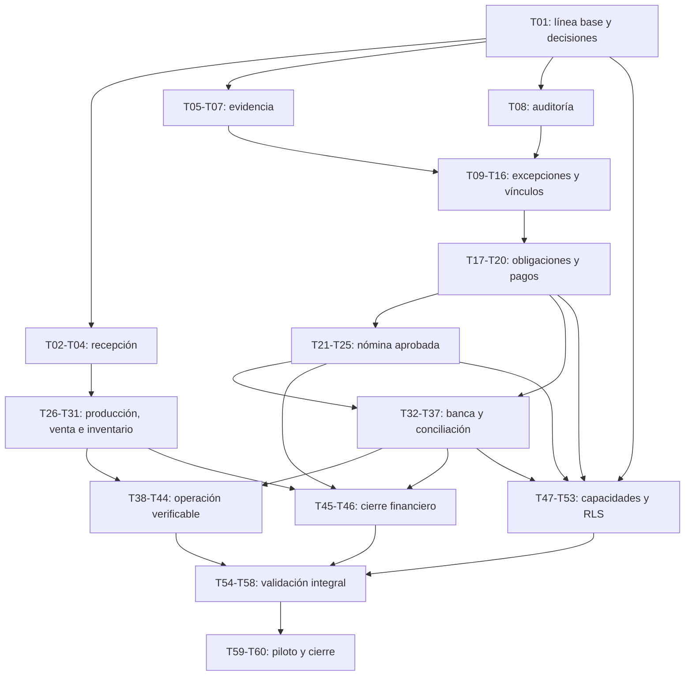

# Plan de implementación: cierre de cumplimiento de Pulso

Fecha: 17 de octubre de 2026. Estado: **plan preparado para revisión; implementación no iniciada por este trabajo**.

## Objetivo y fuentes

Cerrar los circuitos operativos y financieros del [reporte de cumplimiento](../docs/reporte-cumplimiento-sistema-2026-10-17.md) sin reconstruir los módulos existentes. La [matriz fuente](../docs/matriz-cumplimiento-sistema-2026-10-17.csv) aporta 239 puntos: 98 implementados en código, 98 parciales, 39 con base por verificar y cuatro sin implementación localizada. Esos estados son la línea base técnica, no resultados operativos ni una certificación.

Este documento contiene el orden y las fichas de trabajo. [todo.md](todo.md) es el tracker. El apéndice asigna una tarea primaria a cada ID; T54 consolida la evidencia de todos los puntos, incluidos los ya implementados.

Se reutiliza [Phase 0 — Control Core](plan-closeout-pulso-1.0-phase-0.md) como antecedente, corrigiendo sus dependencias, tamaño de tareas y supuestos: no copiar números fijos de migración, no dar seguridad/doble firma por desplegadas y no cerrar Phase 0 por sus casillas. También se revisó el [plan RLS previo](../docs/closeout-pulso-1.0/PHASE--1-RLS-PLAN.md).

Los anteriores archivos generales trataban el dashboard ejecutivo y se conservaron íntegros en [respaldo del plan](plan-archive-before-cumplimiento-2026-10-17.md) y [respaldo del tracker](todo-archive-before-cumplimiento-2026-10-17.md). Este plan no cancela ese trabajo.

## Evidencia consultada y límites

- Reporte completo, matriz de 239 IDs, plan de Phase 0, plan RLS, scripts de package.json y configuración real de Vitest/Playwright.
- CodeGraph: contexto de servicios y exploración de tesorería, producción, ingestión, consumo y nómina, más inventario de esquemas y pruebas. Las consultas posteriores de nombres de componentes fallaron por transporte; sus puntos de montaje se deben confirmar en T01.
- El árbol ya contiene cambios locales en rutas de nómina/notificaciones, tesorería, política de dispersión y tests de seguridad. No se modifican ni se declaran cerrados. T01 debe distinguir qué aporta cada cambio antes de implementar.
- El reporte documenta 1,471 pruebas unitarias aprobadas; tipos y build no estaban aprobados, y no se habían ejecutado E2E. No se ejecutaron nuevamente durante esta planificación.
- Los nombres de archivos marcados como nuevos son propuestas; los marcados «confirmar» son puntos por localizar. Los comandos de prueba descritos son verificaciones futuras, no resultados.

## Decisiones de arquitectura

1. **Reutilizar recorridos productivos.** CxP ya actualiza facturas/gastos al liquidar y venta ya invoca consumo. Se cierran correcciones, fallos y trazabilidad sobre esos servicios.
2. **Evidencia durable primero.** Registro en DB y archivo son piezas distintas. Permiso por sujeto/empresa/sucursal; URLs firmadas solo después de autorizar. Conservar referencias legadas hasta backfill y paridad. El almacenamiento local no garantiza acceso entre servidores.
3. **Excepción como control transversal.** Fuentes de dominio siguen siendo verdad de negocio. Identidad por ocurrencia: reintento no duplica, nueva reincidencia sí puede producir nuevo caso. Resolución, verificación independiente y cierre no conceden automáticamente aprobación de gasto/pago.
4. **Consistencia y recuperación explícitas.** Transacciones para escrituras de la misma DB; outbox/efectos idempotentes para servicios externos. Control de versión y restricciones DB resuelven concurrencia. GET no sincroniza ni escribe. Fallos críticos de auditoría deben impedir conclusión silenciosa o quedar en outbox durable.
5. **Nómina usa una versión aprobada.** Conceptos con fuentes laborales y políticas validadas por RH. Snapshot aprobado alimenta recibo, CFDI, obligación neta y labor cost; cambios posteriores invalidan aprobación. Reglas fiscales/tasas se validan durante implementación con responsables y fuentes oficiales.
6. **Producción y venta comparten contrato de consumo.** Lote terminado con fracciones, costo y genealogía. Insumo descontado al producir no vuelve a descontarse al vender esa subreceta. Corrección/anulación revierte el efecto histórico, no recalcula silenciosamente con receta/precio actual.
7. **Banco propio es un ledger distinto.** Cuenta de empresa separada de cuenta de proveedor/payee. Liquidación manual no equivale a movimiento conciliado. Asignaciones admiten parciales, comisiones y reversos con saldos conservados.
8. **Capacidades y alcances sobre roles actuales.** Ocho perfiles de negocio no obligan a ocho roles nuevos. Guardas del servidor desde la primera entrega; T47–T49 cierran cobertura transversal. Colaborador restringido a trabajo propio según requisito.
9. **RLS por lotes ensayados.** Contexto local de transacción, rol runtime no owner/sin BYPASSRLS y pruebas con pool real antes de activar políticas. Los controles de aplicación y de sucursal se conservan. El primer lote RLS no equivale a cubrir automáticamente todas las tablas.
10. **Compatibilidad y cambios aditivos.** Revisar migración contra esquema/journal actuales; generar numeración vigente. No usar db:push para este cierre, borrar tablas paralelas o retirar fallbacks sin una entrega de paridad independiente.
11. **UI integrada.** Cada slice modifica el flujo vigente y sigue PRODUCT.md/DESIGN.md: Geist, capas tonales sin sombras, rojo operativo acotado y estados de carga/error/permiso visibles. Un componente nuevo sin montaje en el flujo no cumple aceptación.

## Dependencias y orden

El diagrama resume hitos; las dependencias de cada ficha son las autoritativas. El orden numerado es ejecutable en serie. Las verificaciones de esquema/servicio se integran en el mismo slice o quedan detrás de compatibilidad hasta conectar su lector/API/UI.

| Bloque | Tareas | Resultado |
|---|---|---|
| Preparación | T01–T01 | Línea base y decisiones |
| Recepción | T02–T04 | Slices funcionales y verificables |
| Control común | T05–T16 | Slices funcionales y verificables |
| Pagos | T17–T20 | Slices funcionales y verificables |
| Nómina | T21–T25 | Slices funcionales y verificables |
| Producción y ventas | T26–T31 | Slices funcionales y verificables |
| Banca | T32–T37 | Slices funcionales y verificables |
| Operación | T38–T44 | Slices funcionales y verificables |
| Finanzas | T45–T46 | Slices funcionales y verificables |
| Acceso y DB | T47–T53 | Slices funcionales y verificables |
| Validación integral | T54–T60 | Pruebas, piloto y evidencia de cierre |

Recepción se atiende primero por errores concretos de costo y temperatura. Evidencia/auditoría preceden a la excepción y a pagos. Las políticas de acceso se aplican en cada slice: no se pospone seguridad hasta el bloque final.

## Cómo ejecutar y verificar

**Tamaño:** S = 1–2 archivos de implementación o entrega documental acotada; M = 3–5 archivos manuales incluyendo tests. Las listas son estimaciones, no autorización para ampliar alcance. Si localizar un padre UI, un consumidor RLS u otra integración exige un sexto archivo manual, dividir la ficha antes de empezar y actualizar dependencias/tracker. Artefactos automáticos de Drizzle (SQL generado, journal, snapshots) se revisan junto a su tarea; SQL RLS escrito a mano sí cuenta en el límite.

**Ciclo por tarea:** confirmar estado actual → reproducir caso/fixture → implementar slice → verificar criterios y no regresión → registrar evidencia → marcar casilla. Una verificación que encuentra otro defecto abre una nueva tarea S/M; no absorbe reparaciones ilimitadas. Las estimaciones son de alcance; no se prometen semanas sin datos, bancos, accesos y políticas definidos.

| Código | Verificación futura |
|---|---|
| V-U | `pnpm exec vitest run --configLoader bundle --maxWorkers=2 <filtro>`. El filtro de cada ficha apunta al test existente o propuesto; cero tests seleccionados no cuenta como aprobado. Suite completa sin filtro en gates mayores. |
| V-T | `pnpm exec tsc --noEmit --incremental false`. Ejecutar solo, sin competir con Vitest/build; registrar salida y código de proceso. |
| V-B | `pnpm run build`. Ejecutar sin dev server que comparta .next y sin pruebas en paralelo. |
| V-L | `pnpm exec eslint <archivos modificados>`; registrar deuda previa aparte. |
| V-E | `pnpm exec playwright test <spec> --project=chromium --workers=1`, con DB/tenant de prueba, auth fixtures y servidor/Inngest preparados. Specs nuevos son entregables de la ficha. |
| V-M | `pnpm db:generate` cuando cambie esquema; revisar SQL/journal, sin pérdidas de datos. Para SQL manual RLS, registrar migración compatible con journal. Ensayar `pnpm db:migrate` únicamente en DB aislada y probar rollback/recuperación. |
| V-D | Revisar IDs, dependencias, enlaces, criterios y diferencias de Git; no declarar prueba/aceptación ausente. |

Para Playwright local, usar PowerShell `$env:PLAYWRIGHT_WEB_SERVER_CMD='pnpm run dev'` y `INNGEST_DEV=1` en el servidor. La configuración actual exige servidor Inngest; observar su registro en /api/inngest. Para staging, fijar PLAYWRIGHT_TEST_BASE_URL y preparar explícitamente infraestructura/credenciales, sin arrancar accidentalmente infraestructura local con datos de producción.

**Barra común de aceptación:** auth/getSession y scope fail-closed; rechazo de lectura/escritura ajena; importes/cantidades conservados; reintento recuperable; auditoría/evidencia cuando corresponde; ningún estado exitoso falso. Pruebas unitarias con mocks no sustituyen transacciones, reinicio, rol DB o E2E reales. Timbrado/transferencias/notificaciones externas se prueban con sandbox o adaptadores controlados; el piloto operativo se acuerda en T59.

**Checkpoints:** cada tres tareas se revisan pruebas focalizadas, integración y alcance. Si hubo código, V-T/V-B/V-L deben pasar o documentar un bloqueo que impide cerrar el checkpoint. No repetir indiscriminadamente suites sin cambios nuevos. Gates mayores añaden suite completa y revisión de evidencia del circuito.

**Antes de implementar:** revisión humana de este plan pendiente, conforme a la habilidad invocada. Preparar el plan no implica autorizar migraciones, despliegues, pagos, timbrados reales ni envío de mensajes. No se pide aprobación para seguir redactando estos entregables.

## Fichas de trabajo

### T01: Fijar línea base y decisiones de ejecución

**Bloque:** Preparación. **Descripción:** Conciliar los 239 puntos de la matriz con los cambios locales y Phase 0; registrar evidencias existentes, fixtures de dos empresas y decisiones que condicionan cada entrega.

**Criterios de aceptación:**

- [ ] Cada ID conserva estado original, tarea responsable y prueba pendiente; ningún checkbox histórico se usa como evidencia.
- [ ] Quedan identificados bancos/POS objetivo, políticas de nómina/temperatura/SLA, alcance de conectores y responsables de validación; decisiones pendientes bloquean solo su tarea dependiente.
- [ ] Se registra estado de Git y resultados reales de verificaciones, sin tocar los cambios locales ajenos.

**Verificación:** Revisión de los 239 IDs y ejecución secuencial de V-U, V-T y V-B; documentar fallos previos y recursos, sin declararlos resueltos.

**Dependencias:** Ninguna.

**Archivos probables (rutas nuevas/provisionales indicadas):**

- `docs/closeout-pulso-1.0/00-STATUS.md`
- `docs/closeout-pulso-1.0/DECISIONES-CUMPLIMIENTO.md (nuevo)`
- `docs/closeout-pulso-1.0/COBERTURA-239.md (nuevo)`

**Alcance estimado:** M (3 archivos listados; revisar integración antes de empezar).

### T02: Conservar valor al convertir unidades

**Bloque:** Recepción. **Descripción:** Corregir el costo inverso usando cantidad original y conversión validada; reutilizar UnitConversionService.

**Criterios de aceptación:**

- [ ] 2 cajas de 10 kg a $1,000/caja producen 20 kg a $100/kg, total $2,000.
- [ ] Fracciones conservan valor con redondeo monetario documentado; conversiones incompatibles o cantidades inválidas se rechazan.

**Verificación:** V-U con receiving-cost; tabla de casos con identidad, cajas/kg y fracciones.

**Dependencias:** T01.

**Archivos probables (rutas nuevas/provisionales indicadas):**

- `lib/services/receiving-service.ts`
- `lib/services/unit-conversion-service.ts`
- `lib/services/__tests__/receiving-cost.test.ts (nuevo)`

**Alcance estimado:** M (3 archivos listados; revisar integración antes de empezar).

### T03: Exigir lectura de temperatura según política

**Bloque:** Recepción. **Descripción:** Distinguir ausencia de lectura, conformidad, rechazo y cuarentena por almacenamiento; la omisión excepcional requiere autorización y motivo.

**Criterios de aceptación:**

- [ ] Un producto que exige medición no entra como conforme sin lectura; el bypass registra actor, permiso y motivo.
- [ ] Lectura fuera de rango conserva cuarentena y reclamo; productos exentos siguen una política explícita.
- [ ] API y captura muestran la misma validación, sin asumir umbrales normativos nuevos.

**Verificación:** V-U receiving-temperature; V-E tests/compliance-receiving-temperature.spec.ts (nuevo), incluyendo omisión y bypass denegado.

**Dependencias:** T01.

**Archivos probables (rutas nuevas/provisionales indicadas):**

- `lib/services/receiving-temperature.ts`
- `lib/services/receiving-service.ts`
- `lib/services/__tests__/receiving-temperature.test.ts`
- `tests/compliance-receiving-temperature.spec.ts (nuevo)`
- `components/receiving/temperature-policy-input.tsx (nuevo; integrar en captura localizada en T01)`

**Alcance estimado:** M (5 archivos listados; revisar integración antes de empezar).

#### Checkpoint CP01: T01–T03

- [ ] Criterios y verificaciones de estas tres tareas documentados con artefactos.
- [ ] Pruebas focalizadas e integración aprobadas; V-T/V-B/V-L si hubo código, ejecutados secuencialmente.
- [ ] No hay regresión o dependencia incumplida que impida continuar; revisión del alcance antes del siguiente bloque.

### T04: Recuperar recepción sin duplicar entradas

**Bloque:** Recepción. **Descripción:** Hacer coherentes reporte, lotes y movimientos con transacción o efecto durable recuperable; usar identidad del workflow/documento y concurrencia.

**Criterios de aceptación:**

- [ ] Fallar entre reporte y stock permite recuperar sin entradas parciales presentadas como completas.
- [ ] Repetición y dos ejecuciones simultáneas generan un único conjunto de movimientos.
- [ ] Factura, OC y reclamo mantienen referencias al reporte confirmado.

**Verificación:** V-U receiving-recovery; V-E tests/compliance-receiving-recovery.spec.ts (nuevo), inyectando fallo intermedio.

**Dependencias:** T02, T03.

**Archivos probables (rutas nuevas/provisionales indicadas):**

- `lib/services/receiving-service.ts`
- `lib/services/receiving-extractor.ts (confirmar ubicación en T01)`
- `lib/services/__tests__/receiving-recovery.test.ts (nuevo)`
- `tests/compliance-receiving-recovery.spec.ts (nuevo)`

**Alcance estimado:** M (4 archivos listados; revisar integración antes de empezar).

**Gate G-R:** Recepción conserva valor, exige temperatura y recupera efectos. No se marca cerrado sin evidencia del circuito.

### T05: Persistir EvidenceStore

**Bloque:** Control común. **Descripción:** Agregar índice durable al almacenamiento ya usado, conservando firmas públicas y metadatos de empresa, sucursal, sujeto, autor y verificación; no reconstruir R2.

**Criterios de aceptación:**

- [ ] Dos procesos recuperan la misma evidencia tras reinicio; no depende de Map local.
- [ ] Una clave estable evita duplicar el registro y mantiene el vínculo al archivo; fallo de subida no crea evidencia utilizable falsa.
- [ ] Migración aditiva y exportación del esquema revisadas; fallback local identificado como limitado al entorno que lo almacena.

**Verificación:** V-U evidence-store; integración de persistencia entre procesos en DB aislada; V-M.

**Dependencias:** T01.

**Archivos probables (rutas nuevas/provisionales indicadas):**

- `lib/db/schema/evidence.ts (nuevo)`
- `lib/db/schema/index.ts`
- `lib/services/evidence-store.ts`
- `lib/services/__tests__/evidence-store.test.ts (nuevo)`

**Alcance estimado:** M (4 archivos listados; revisar integración antes de empezar).

### T06: Autorizar consulta y revisión de evidencia

**Bloque:** Control común. **Descripción:** Exponer consulta y actualización de verificación sobre la fachada común, ampliando sujetos a workflow, excepción, gasto, factura, pago y aprobación; heredar autorización del sujeto.

**Criterios de aceptación:**

- [ ] Otra empresa y una sucursal fuera de alcance no recuperan registro, archivo ni URL firmada.
- [ ] Revisión humana/IA persiste resultado, autor y fecha; no confunde revisión automática con aprobación financiera.
- [ ] Un workflow conserva evidencia durable y sus URLs existentes durante la transición.

**Verificación:** V-U evidence-access; V-E tests/compliance-evidence.spec.ts (nuevo) con dos empresas y reinicio.

**Dependencias:** T05.

**Archivos probables (rutas nuevas/provisionales indicadas):**

- `lib/api/evidence-access.ts (nuevo)`
- `app/api/evidence/route.ts (nuevo o adaptar)`
- `lib/services/evidence-store.ts`
- `lib/services/__tests__/evidence-access.test.ts (nuevo)`
- `tests/compliance-evidence.spec.ts (nuevo)`

**Alcance estimado:** M (5 archivos listados; revisar integración antes de empezar).

#### Checkpoint CP02: T04–T06

- [ ] Criterios y verificaciones de estas tres tareas documentados con artefactos.
- [ ] Pruebas focalizadas e integración aprobadas; V-T/V-B/V-L si hubo código, ejecutados secuencialmente.
- [ ] No hay regresión o dependencia incumplida que impida continuar; revisión del alcance antes del siguiente bloque.

### T07: Importar referencias históricas de evidencia

**Bloque:** Control común. **Descripción:** Crear backfill con dry-run, lotes reanudables y reporte de referencias de workflows, incidentes y órdenes de servicio; no borrar URLs de origen.

**Criterios de aceptación:**

- [ ] Dos pasadas no duplican; cursor reanuda tras fallo y produce conteos por empresa/origen.
- [ ] Referencias inaccesibles o sin dueño se reportan y no se adjudican a otra empresa.

**Verificación:** Dry-run en copia aislada; V-U evidence-backfill y comparación de conteos antes/después.

**Dependencias:** T05, T06.

**Archivos probables (rutas nuevas/provisionales indicadas):**

- `scripts/backfill-evidence.ts (nuevo)`
- `lib/services/evidence-backfill.ts (nuevo)`
- `lib/services/__tests__/evidence-backfill.test.ts (nuevo)`

**Alcance estimado:** M (3 archivos listados; revisar integración antes de empezar).

### T08: Unificar auditoría consultable

**Bloque:** Control común. **Descripción:** Reutilizar logs existentes con lectura paginada por sujeto y correlación, más un writer obligatorio para acciones críticas; definir atomicidad o outbox para auditoría financiera.

**Criterios de aceptación:**

- [ ] Consulta unificada presenta actor, acción, fecha, antes/después, motivo y fuente; falta histórica se identifica como tal.
- [ ] Acción crítica sin motivo o persistencia durable de auditoría no concluye silenciosamente.
- [ ] Lectura y exportación respetan empresa, sucursal y sensibilidad.

**Verificación:** V-U audit-trail; V-E tests/compliance-audit.spec.ts (nuevo), incluyendo fallo del writer.

**Dependencias:** T01.

**Archivos probables (rutas nuevas/provisionales indicadas):**

- `lib/services/audit-trail-service.ts (nuevo)`
- `lib/security/audit.ts`
- `app/api/audit/trail/route.ts (nuevo)`
- `lib/services/__tests__/audit-trail.test.ts (nuevo)`
- `tests/compliance-audit.spec.ts (nuevo)`

**Alcance estimado:** M (5 archivos listados; revisar integración antes de empezar).

### T09: Definir identidad y estados de excepción

**Bloque:** Control común. **Descripción:** Crear esquema y máquina de estados sobre vocabulario vigente; una ocurrencia estable identifica la excepción y permite reincidencia tras cierre.

**Criterios de aceptación:**

- [ ] Estados cubren asignación, acción, resolución, verificación, cierre, escalamiento y reapertura con guardas probadas.
- [ ] Resolvedor no puede verificar su propia resolución; cierre exige verificación y evidencia conforme a política.
- [ ] Misma ocurrencia reintentada no duplica; nuevo evento del mismo sujeto no queda absorbido por un índice excesivamente amplio.

**Verificación:** V-U exception-lifecycle; V-M revisando unicidad por empresa+fuente+ocurrencia, sin copiar números de migración del plan anterior.

**Dependencias:** T01, T05.

**Archivos probables (rutas nuevas/provisionales indicadas):**

- `lib/db/schema/exceptions.ts (nuevo)`
- `lib/db/schema/index.ts`
- `lib/services/exception-lifecycle.ts (nuevo)`
- `lib/services/__tests__/exception-lifecycle.test.ts (nuevo)`

**Alcance estimado:** M (4 archivos listados; revisar integración antes de empezar).

#### Checkpoint CP03: T07–T09

- [ ] Criterios y verificaciones de estas tres tareas documentados con artefactos.
- [ ] Pruebas focalizadas e integración aprobadas; V-T/V-B/V-L si hubo código, ejecutados secuencialmente.
- [ ] No hay regresión o dependencia incumplida que impida continuar; revisión del alcance antes del siguiente bloque.

### T10: Persistir acciones de excepción

**Bloque:** Control común. **Descripción:** Implementar comandos transaccionales con control de versión, owner y SLA; no cambiar estado del documento de origen por una mera proyección.

**Criterios de aceptación:**

- [ ] Mutaciones concurrentes y reintentos conservan una única transición válida y auditoría durable.
- [ ] Owner pertenece al alcance; ausencia de responsable queda visible y escalable.
- [ ] No se verifica ni cierra sin autorización, motivo y evidencia requeridos; fuente conserva su resolución de negocio.

**Verificación:** V-U exception-service con concurrencia; integración real de unicidad y rollback en DB aislada.

**Dependencias:** T08, T09.

**Archivos probables (rutas nuevas/provisionales indicadas):**

- `lib/services/exception-service.ts (nuevo)`
- `lib/services/exception-sla.ts (nuevo)`
- `lib/services/__tests__/exception-service.test.ts (nuevo)`

**Alcance estimado:** M (3 archivos listados; revisar integración antes de empezar).

### T11: Cerrar una factura discrepante de extremo a extremo

**Bloque:** Control común. **Descripción:** Integrar matching con excepción canónica y sus acciones API; adjuntar evidencia durable sin convertir verificación de excepción en autorización automática de pago.

**Criterios de aceptación:**

- [ ] Discrepancia crea una ocurrencia con owner/SLA y vínculo a factura/evidencia.
- [ ] Actores distintos resuelven y verifican; cierre y reapertura quedan auditados.
- [ ] La factura continúa bloqueada para pago mientras su política específica no autorice la diferencia.

**Verificación:** V-U invoice-matching-exception; V-E tests/compliance-invoice-exception.spec.ts (nuevo).

**Dependencias:** T06, T10.

**Archivos probables (rutas nuevas/provisionales indicadas):**

- `lib/services/invoice-matching-service.ts`
- `app/api/exceptions/route.ts (nuevo o adaptar)`
- `app/api/exceptions/[id]/route.ts (nuevo o adaptar; comandos validados)`
- `lib/services/__tests__/invoice-matching-exception.test.ts`
- `tests/compliance-invoice-exception.spec.ts (nuevo)`

**Alcance estimado:** M (5 archivos listados; revisar integración antes de empezar).

### T12: Proyectar temperatura, merma y equipo

**Bloque:** Control común. **Descripción:** Agregar adaptadores hacia la excepción común para estos tres casos operativos, preservando los writers originales.

**Criterios de aceptación:**

- [ ] Cada fuente obtiene identidad de ocurrencia, severidad, owner y SLA reproducibles.
- [ ] Repetir sincronización no duplica; resolver la proyección no elimina cuarentena, merma o mantenimiento.
- [ ] Cada caso adjunta evidencia y admite cierre/reapertura con verificador independiente.

**Verificación:** V-U exception-operational-adapters con tres casos y dos empresas.

**Dependencias:** T10, T11.

**Archivos probables (rutas nuevas/provisionales indicadas):**

- `lib/services/exception-adapters/temperature.ts (nuevo)`
- `lib/services/exception-adapters/waste.ts (nuevo)`
- `lib/services/exception-adapters/equipment.ts (nuevo)`
- `lib/services/__tests__/exception-operational-adapters.test.ts (nuevo)`

**Alcance estimado:** M (4 archivos listados; revisar integración antes de empezar).

#### Checkpoint CP04: T10–T12

- [ ] Criterios y verificaciones de estas tres tareas documentados con artefactos.
- [ ] Pruebas focalizadas e integración aprobadas; V-T/V-B/V-L si hubo código, ejecutados secuencialmente.
- [ ] No hay regresión o dependencia incumplida que impida continuar; revisión del alcance antes del siguiente bloque.

### T13: Proyectar presupuesto, falta y pago sin conciliar

**Bloque:** Control común. **Descripción:** Agregar los tres adaptadores restantes; el de pago define desde ahora el contrato para la fuente bancaria de T34, sin declarar una liquidación manual como conciliada.

**Criterios de aceptación:**

- [ ] Gasto fuera de presupuesto y ausencia recorren el mismo lifecycle sin alterar su autorización de dominio.
- [ ] Pago sin conciliación conserva fuente y antigüedad; T34 alimentará su detección bancaria real.
- [ ] Reintentos y reincidencias mantienen identidades correctas y permisos de datos sensibles.

**Verificación:** V-U exception-financial-people-adapters; fixture bancario provisional explícito hasta T34.

**Dependencias:** T10, T11.

**Archivos probables (rutas nuevas/provisionales indicadas):**

- `lib/services/exception-adapters/budget.ts (nuevo)`
- `lib/services/exception-adapters/absence.ts (nuevo)`
- `lib/services/exception-adapters/unreconciled-payment.ts (nuevo)`
- `lib/services/__tests__/exception-financial-people-adapters.test.ts (nuevo)`

**Alcance estimado:** M (4 archivos listados; revisar integración antes de empezar).

### T14: Ejecutar sincronización y escalamiento durables

**Bloque:** Control común. **Descripción:** Registrar función Inngest con recuperación periódica y disparo tras eventos; SLA usa tiempo y responsables configurados sin escrituras desde GET.

**Criterios de aceptación:**

- [ ] Caída de Inngest y reenvío posterior recuperan las fuentes sin duplicados.
- [ ] Adaptador fallido no oculta los otros; reintentos, fallos y cola pendiente son observables.
- [ ] Vencimiento notifica/escalona una vez por ocurrencia y nivel, preservando destinatarios autorizados.

**Verificación:** V-U exceptions-sync; integración en Inngest Dev Server desconectándolo y reanudándolo.

**Dependencias:** T12, T13.

**Archivos probables (rutas nuevas/provisionales indicadas):**

- `lib/inngest/functions/exceptions-sync.ts (nuevo)`
- `lib/inngest/functions/index.ts`
- `lib/services/exception-sla.ts (nuevo o adaptar)`
- `lib/services/__tests__/exceptions-sync.test.ts (nuevo)`

**Alcance estimado:** M (4 archivos listados; revisar integración antes de empezar).

### T15: Operar excepciones desde el feed

**Bloque:** Control común. **Descripción:** Conectar lector canónico y UI existente a comandos de asignación, resolución, verificación, cierre y reapertura; conservar fuentes legadas hasta paridad comprobada.

**Criterios de aceptación:**

- [ ] Feed muestra responsable, vencimiento, fuente y estado sin duplicar entradas legadas.
- [ ] Acciones visibles coinciden con permisos API; errores de versión permiten recargar sin perder contexto.
- [ ] Owner/supervisor completan el circuito desde navegador conforme a PRODUCT.md y DESIGN.md.

**Verificación:** V-U group-exceptions-service; V-E tests/compliance-exceptions-ui.spec.ts (nuevo), teclado y vista móvil.

**Dependencias:** T11, T14.

**Archivos probables (rutas nuevas/provisionales indicadas):**

- `lib/services/group-exceptions-service.ts`
- `app/dashboard/exceptions/page.tsx`
- `components/exceptions/lifecycle-actions.tsx (nuevo)`
- `lib/services/__tests__/group-exceptions-service.test.ts`
- `tests/compliance-exceptions-ui.spec.ts (nuevo)`

**Alcance estimado:** M (5 archivos listados; revisar integración antes de empezar).

#### Checkpoint CP05: T13–T15

- [ ] Criterios y verificaciones de estas tres tareas documentados con artefactos.
- [ ] Pruebas focalizadas e integración aprobadas; V-T/V-B/V-L si hubo código, ejecutados secuencialmente.
- [ ] No hay regresión o dependencia incumplida que impida continuar; revisión del alcance antes del siguiente bloque.

### T16: Vincular evidencia de documentos financieros

**Bloque:** Control común. **Descripción:** Integrar write-through de evidencia para gasto, factura, pago y aprobación mediante la fachada común, manteniendo referencias actuales.

**Criterios de aceptación:**

- [ ] Cada sujeto recupera archivo y verificación después de reiniciar, con permisos heredados.
- [ ] Fallo entre archivo y documento es recuperable y no produce vínculos cruzados ni adjuntos duplicados.
- [ ] No se elimina evidencia histórica ni se sustituye aprobación por mera existencia del archivo.

**Verificación:** V-U financial-evidence; repetir caso financiero de V-E compliance-evidence en DB aislada.

**Dependencias:** T06, T08, T11.

**Archivos probables (rutas nuevas/provisionales indicadas):**

- `lib/services/expense-service.ts`
- `app/api/inventory/invoices/upload/route.ts`
- `lib/services/treasury-service.ts`
- `lib/services/evidence-store.ts`
- `lib/services/__tests__/financial-evidence.test.ts (nuevo)`

**Alcance estimado:** M (5 archivos listados; revisar integración antes de empezar).

**Gate G-0:** Factura discrepante tiene owner/SLA, evidencia durable, verificación independiente y auditoría. No se marca cerrado sin evidencia del circuito.

### T17: Alinear políticas de aprobación

**Bloque:** Pagos. **Descripción:** Definir contrato de evaluación de capacidades, monto, preparador, aprobador y excepción; conservar reglas específicas OC/OS, gasto y tesorería.

**Criterios de aceptación:**

- [ ] Casos equivalentes tienen decisiones explicables y auditadas; reglas de cada documento no se pierden.
- [ ] Cambiar monto, beneficiario o cuenta invalida aprobación anterior.
- [ ] Pruebas impiden autoaprobación y preservan doble firma local sin asumir que ya está desplegada.

**Verificación:** V-U approval-policy y treasury-disbursement; matriz de decisiones aprobada por responsable financiero.

**Dependencias:** T08, T10, T16.

**Archivos probables (rutas nuevas/provisionales indicadas):**

- `lib/services/approval-matrix-service.ts`
- `lib/treasury/disbursement-policy.ts`
- `lib/services/approval-policy.ts (nuevo)`
- `lib/services/__tests__/approval-policy.test.ts (nuevo)`

**Alcance estimado:** M (4 archivos listados; revisar integración antes de empezar).

### T18: Trazar solicitud pagable hasta su documento

**Bloque:** Pagos. **Descripción:** Dar identidad y consulta a solicitudes sobre obligaciones existentes; validar monto autoritativo, proveedor/payee, autorización y evidencia desde factura o gasto.

**Criterios de aceptación:**

- [ ] Factura discrepante y gasto no autorizado permanecen no pagables; no se confía en monto del cliente.
- [ ] Solicitud conserva cadena documento→aprobación→partida y devuelve estado real.
- [ ] Consulta y selección para corrida se limitan a empresa/sucursal y capacidades financieras.

**Verificación:** V-U payable-request; V-E tests/compliance-payment-request.spec.ts (nuevo).

**Dependencias:** T17.

**Archivos probables (rutas nuevas/provisionales indicadas):**

- `lib/services/accounts-payable-service.ts`
- `lib/services/treasury-service.ts`
- `app/api/treasury/payment-requests/route.ts (nuevo o adaptar)`
- `lib/services/__tests__/payable-request.test.ts (nuevo)`
- `tests/compliance-payment-request.spec.ts (nuevo)`

**Alcance estimado:** M (5 archivos listados; revisar integración antes de empezar).

#### Checkpoint CP06: T16–T18

- [ ] Criterios y verificaciones de estas tres tareas documentados con artefactos.
- [ ] Pruebas focalizadas e integración aprobadas; V-T/V-B/V-L si hubo código, ejecutados secuencialmente.
- [ ] No hay regresión o dependencia incumplida que impida continuar; revisión del alcance antes del siguiente bloque.

### T19: Evitar duplicados y cambios después de firma

**Bloque:** Pagos. **Descripción:** Fortalecer reservas y snapshots de la corrida bajo concurrencia; integrar invalidación de firmas y trazabilidad de cuenta verificada.

**Criterios de aceptación:**

- [ ] Dos corridas simultáneas no reservan/pagan por encima del saldo de la misma obligación.
- [ ] Cambio de cuenta o monto revoca firmas y layout; quien prepara no satisface su propia firma requerida.
- [ ] Reintento retorna misma partida y auditoría correlacionada.

**Verificación:** V-U treasury-concurrency y lib/treasury/__tests__; prueba DB con dos transacciones reales.

**Dependencias:** T17, T18.

**Archivos probables (rutas nuevas/provisionales indicadas):**

- `lib/services/treasury-service.ts`
- `lib/treasury/disbursement-policy.ts`
- `lib/db/schema/treasury.ts`
- `lib/services/__tests__/treasury-concurrency.test.ts (nuevo)`

**Alcance estimado:** M (4 archivos listados; revisar integración antes de empezar).

### T20: Verificar liquidación documental existente

**Bloque:** Pagos. **Descripción:** Conservar actualización CxP ya implementada y probar confirmación/fallo por partida; separar estado de liquidación manual del futuro estado bancario.

**Criterios de aceptación:**

- [ ] Solo partida confirmada actualiza saldo/documento según monto; fallida permanece pendiente.
- [ ] Referencia manual y evidencia quedan auditadas sin etiquetarse como conciliación bancaria.
- [ ] Compra→recepción→factura→aprobación→corrida→liquidación funciona con reintentos.

**Verificación:** V-U payment-run-settlement; V-E tests/compliance-ap-settlement.spec.ts (nuevo).

**Dependencias:** T04, T18, T19.

**Archivos probables (rutas nuevas/provisionales indicadas):**

- `lib/services/treasury-service.ts`
- `lib/services/__tests__/payment-run-settlement.test.ts`
- `tests/compliance-ap-settlement.spec.ts (nuevo)`

**Alcance estimado:** M (3 archivos listados; revisar integración antes de empezar).

**Gate G-P:** Obligación autorizada llega a liquidación sin duplicados ni firmas inválidas. No se marca cerrado sin evidencia del circuito.

### T21: Consolidar incidencias laborales aprobadas

**Bloque:** Nómina. **Descripción:** Crear lectura versionada por empleado/período de horarios, sesiones, aprobaciones, faltas, permisos, vacaciones y propinas, con reglas de zona horaria.

**Criterios de aceptación:**

- [ ] Se distinguen horas programadas, trabajadas y aprobadas; ausencia de datos no equivale a cero incidencias.
- [ ] Turno nocturno, feriado y cambio de sucursal no duplican horas ni conceptos.
- [ ] Fuente identifica aprobación y permite explicar cada incidencia sin exponer otros empleados.

**Verificación:** V-U payroll-attendance y attendance-mexican-cadence con zona explícita.

**Dependencias:** T01, T08.

**Archivos probables (rutas nuevas/provisionales indicadas):**

- `lib/services/payroll-attendance-service.ts (nuevo)`
- `lib/services/payroll-service.ts`
- `lib/services/__tests__/payroll-attendance.test.ts (nuevo)`

**Alcance estimado:** M (3 archivos listados; revisar integración antes de empezar).

#### Checkpoint CP07: T19–T21

- [ ] Criterios y verificaciones de estas tres tareas documentados con artefactos.
- [ ] Pruebas focalizadas e integración aprobadas; V-T/V-B/V-L si hubo código, ejecutados secuencialmente.
- [ ] No hay regresión o dependencia incumplida que impida continuar; revisión del alcance antes del siguiente bloque.

### T22: Calcular conceptos desde asistencia real

**Bloque:** Nómina. **Descripción:** Usar reglas existentes y políticas confirmadas para base, overtime, faltas, vacaciones, bono, deducción, festivos y propinas; no fijar reglas fiscales inventadas.

**Criterios de aceptación:**

- [ ] Período patrón con falta, vacaciones, horas extra, bono y deducción obtiene desglose reproducible en centavos.
- [ ] Cada concepto mantiene origen/regla y categoría; neto equivale a percepciones menos deducciones.
- [ ] La misma salida alimentará recibo, CFDI y labor cost sin cálculos paralelos.

**Verificación:** V-U payroll-concepts, payroll-holiday y payroll-validation; fixture validado por RH/nómina antes de T23.

**Dependencias:** T21.

**Archivos probables (rutas nuevas/provisionales indicadas):**

- `lib/services/payroll-concepts.ts (nuevo)`
- `lib/services/payroll-service.ts`
- `lib/services/__tests__/payroll-concepts.test.ts (nuevo)`
- `docs/closeout-pulso-1.0/NOMINA-CASOS-ACEPTADOS.md (nuevo)`

**Alcance estimado:** M (4 archivos listados; revisar integración antes de empezar).

### T23: Aprobar una pre-nómina congelada

**Bloque:** Nómina. **Descripción:** Persistir versión de conceptos e incidencias, revisión del gerente y aprobación autorizada; exponer estado y diferencias en captura de pre-nómina.

**Criterios de aceptación:**

- [ ] Solo versión aprobada puede enviarse a ejecución; permiso para ejecutar no sustituye aprobar contenido.
- [ ] Cambiar incidencia invalida aprobación y crea nueva versión, sin mutar la aprobada.
- [ ] Revisión muestra bruto, deducciones, neto y fuentes con límites de sucursal/RH.

**Verificación:** V-U payroll-snapshot; V-E tests/compliance-prenomina.spec.ts (nuevo); V-M.

**Dependencias:** T17, T22.

**Archivos probables (rutas nuevas/provisionales indicadas):**

- `lib/db/schema/payroll-approval.ts (nuevo; reutilizar esquema actual si alcanza)`
- `lib/services/payroll-approval-service.ts (nuevo)`
- `app/api/payroll/validate/route.ts`
- `app/dashboard/payroll/prenomina/page.tsx (nuevo o adaptar)`
- `tests/compliance-prenomina.spec.ts (nuevo)`

**Alcance estimado:** M (5 archivos listados; revisar integración antes de empezar).

### T24: Timbrar exactamente la versión aprobada

**Bloque:** Nómina. **Descripción:** Hacer que ejecución y timbrado consuman snapshot aprobado; recuperar respuestas parciales o ambiguas del proveedor sin crear CFDI duplicado.

**Criterios de aceptación:**

- [ ] Payslip y payload CFDI contienen los conceptos aprobados y guardan UUID/estado por empleado.
- [ ] Tras timeout se consulta estado antes de reemitir; reintento no crea corrida o timbrado duplicado.
- [ ] Rechazo de un empleado queda visible y recuperable; ningún cambio tardío altera el snapshot.

**Verificación:** V-U payroll-stamping; sandbox fiscal con payload/UUID y respuesta conservados, sin timbrado real durante planificación.

**Dependencias:** T23.

**Archivos probables (rutas nuevas/provisionales indicadas):**

- `lib/services/payroll-service.ts`
- `app/api/payroll/run/route.ts`
- `app/api/payroll/route.ts`
- `lib/services/__tests__/payroll-stamping.test.ts (nuevo)`

**Alcance estimado:** M (4 archivos listados; revisar integración antes de empezar).

#### Checkpoint CP08: T22–T24

- [ ] Criterios y verificaciones de estas tres tareas documentados con artefactos.
- [ ] Pruebas focalizadas e integración aprobadas; V-T/V-B/V-L si hubo código, ejecutados secuencialmente.
- [ ] No hay regresión o dependencia incumplida que impida continuar; revisión del alcance antes del siguiente bloque.

### T25: Conciliar neto de nómina y costo laboral

**Bloque:** Nómina. **Descripción:** Vincular corrida aprobada a solicitud de pago y usar sus conceptos para costo laboral; distinguir devengado, timbrado y pagado.

**Criterios de aceptación:**

- [ ] Empleado/período tiene mismo neto entre pre-nómina, payslip, CFDI y obligación en tesorería.
- [ ] Labor cost por sucursal explica diferencias entre devengado y pagado sin sumar nómina dos veces.
- [ ] Pago rechazado permanece pendiente y conserva autorización/evidencia.

**Verificación:** V-U payroll-treasury y labor-cost; escenario completo de nómina antes de G-N.

**Dependencias:** T20, T24.

**Archivos probables (rutas nuevas/provisionales indicadas):**

- `lib/services/payroll-service.ts`
- `lib/services/labor-cost-service.ts`
- `lib/services/treasury-service.ts`
- `lib/services/__tests__/payroll-treasury.test.ts (nuevo)`

**Alcance estimado:** M (4 archivos listados; revisar integración antes de empezar).

**Gate G-N:** Asistencia, snapshot aprobado, recibo, CFDI y neto a pagar coinciden. No se marca cerrado sin evidencia del circuito.

### T26: Elegir modelo productivo canónico

**Bloque:** Producción y ventas. **Descripción:** Documentar writer/reader vigentes y destino de tablas paralelas; decidir consumo físico de subreceta producida versus cálculo teórico analítico.

**Criterios de aceptación:**

- [ ] Una receta producida consume insumos al producir; vender su lote no vuelve a consumir esas materias primas.
- [ ] Quedan definidos unidad/fracciones, yield, caducidad, costo y política de reverso; casos de recetas sin stock producido son explícitos.
- [ ] No se eliminan tablas ni datos paralelos sin inventario y compatibilidad verificables.

**Verificación:** Revisión del contrato con casos de subreceta, plato directo y producto terminado; evidencia CodeGraph de consumidores.

**Dependencias:** T01, T04.

**Archivos probables (rutas nuevas/provisionales indicadas):**

- `docs/closeout-pulso-1.0/PRODUCCION-CONTRATO.md (nuevo)`

**Alcance estimado:** S (1 archivos listados; revisar integración antes de empezar).

### T27: Crear lote terminado de forma atómica

**Bloque:** Producción y ventas. **Descripción:** Completar el recorrido productivo usado con lote de salida, ingredientes FEFO, movimientos y precisión fraccionaria, bajo la misma identidad del efecto.

**Criterios de aceptación:**

- [ ] Producir 1.5 unidades conserva fracción, costo, unidad y caducidad; stock resultante queda utilizable.
- [ ] Consumos de lotes y salida se confirman juntos; fallo revierte o reanuda sin doble movimiento.
- [ ] Reintento y concurrencia no crean dos lotes de salida de la misma ejecución.

**Verificación:** V-U production-finished-batch; integración real con fallo y concurrencia; V-M si requiere índice.

**Dependencias:** T26.

**Archivos probables (rutas nuevas/provisionales indicadas):**

- `lib/services/production-service.ts`
- `lib/services/recipe-production.ts`
- `lib/db/schema/production.ts`
- `lib/services/__tests__/production-finished-batch.test.ts (nuevo)`

**Alcance estimado:** M (4 archivos listados; revisar integración antes de empezar).

#### Checkpoint CP09: T25–T27

- [ ] Criterios y verificaciones de estas tres tareas documentados con artefactos.
- [ ] Pruebas focalizadas e integración aprobadas; V-T/V-B/V-L si hubo código, ejecutados secuencialmente.
- [ ] No hay regresión o dependencia incumplida que impida continuar; revisión del alcance antes del siguiente bloque.

### T28: Consultar genealogía del lote

**Bloque:** Producción y ventas. **Descripción:** Exponer trazabilidad desde salida hasta insumos/caducidad/costo/ejecución y desde lote de entrada hasta sus derivados; conectar al detalle existente.

**Criterios de aceptación:**

- [ ] Se consulta origen y destino de una subreceta sin perder lotes consumidos.
- [ ] Detalle muestra yield, merma, hold time y diferencias plan/real con fuente identificada.
- [ ] Lectura fuera de empresa/sucursal se rechaza; datos históricos incompletos se señalan.

**Verificación:** V-U production-genealogy; V-E tests/compliance-production-lot.spec.ts (nuevo).

**Dependencias:** T27, T06.

**Archivos probables (rutas nuevas/provisionales indicadas):**

- `lib/services/production-genealogy-service.ts (nuevo)`
- `app/api/production/[id]/trace/route.ts (nuevo)`
- `components/production/lot-trace.tsx (nuevo; integrar en detalle actual)`
- `lib/services/__tests__/production-genealogy.test.ts (nuevo)`
- `tests/compliance-production-lot.spec.ts (nuevo)`

**Alcance estimado:** M (5 archivos listados; revisar integración antes de empezar).

### T29: Mapear producto de canal a receta vigente

**Bloque:** Producción y ventas. **Descripción:** Persistir identidad estable POS/canal/producto/SKU y su receta/versionado; reutilizar ingestión y normalización actuales.

**Criterios de aceptación:**

- [ ] Mapeo es por empresa y canal; referencias ambiguas no consumen receta arbitraria.
- [ ] Producto no mapeado queda pendiente accionable y puede reprocesarse al corregir el vínculo.
- [ ] Se conserva origen de ticket/mix/corte y versión de receta usada.

**Verificación:** V-U sales-recipe-mapping; V-E tests/compliance-sales-mapping.spec.ts (nuevo).

**Dependencias:** T26.

**Archivos probables (rutas nuevas/provisionales indicadas):**

- `lib/services/sales-ingest-service.ts`
- `lib/services/sales-recipe-mapping-service.ts (nuevo)`
- `app/api/sales/recipe-mapping/route.ts (nuevo o adaptar)`
- `lib/services/__tests__/sales-recipe-mapping.test.ts (nuevo)`
- `tests/compliance-sales-mapping.spec.ts (nuevo)`

**Alcance estimado:** M (5 archivos listados; revisar integración antes de empezar).

### T30: Recuperar consumo por ventas corregidas

**Bloque:** Producción y ventas. **Descripción:** Sustituir el único efecto para fila nueva por versión/delta idempotente y movimiento reversible; conservar venta→consumo ya conectado.

**Criterios de aceptación:**

- [ ] Importar 10, repetir 10, corregir a 12, reducir a 8 y anular a 0 produce exactamente el efecto neto esperado.
- [ ] Fallo entre venta e insumos se recupera sin omitir ni duplicar movimientos.
- [ ] Dos correcciones concurrentes se serializan; reverso respeta lotes originales y política de período cerrado.

**Verificación:** V-U sales-consumption-recovery; integración DB con varios insumos, fallos parciales y versiones fuera de orden.

**Dependencias:** T27, T29.

**Archivos probables (rutas nuevas/provisionales indicadas):**

- `lib/services/sales-ingest-service.ts`
- `lib/services/theoretical-consumption-service.ts`
- `lib/services/sales-consumption-effects.ts (nuevo)`
- `lib/services/__tests__/sales-consumption-recovery.test.ts (nuevo)`

**Alcance estimado:** M (4 archivos listados; revisar integración antes de empezar).

#### Checkpoint CP10: T28–T30

- [ ] Criterios y verificaciones de estas tres tareas documentados con artefactos.
- [ ] Pruebas focalizadas e integración aprobadas; V-T/V-B/V-L si hubo código, ejecutados secuencialmente.
- [ ] No hay regresión o dependencia incumplida que impida continuar; revisión del alcance antes del siguiente bloque.

### T31: Demostrar integridad de inventario

**Bloque:** Producción y ventas. **Descripción:** Probar la ecuación de stock y costo sobre producción, venta, conteo, merma, transferencia y snapshot; corregir solo la discrepancia que se reproduzca.

**Criterios de aceptación:**

- [ ] Stock final coincide con saldo inicial+entradas+producción−consumo−merma±ajustes/transferencias.
- [ ] Conteos concurrentes y FEFO conservan lotes/caducidad/costo sin doble descuento de subrecetas.
- [ ] PAR, min/max, sugeridos, alto valor y snapshots se verifican con fixtures explicables; función sin prueba sigue pendiente.

**Verificación:** V-U inventory-integrity; V-E tests/compliance-inventory-integrity.spec.ts (nuevo), con conteo contra saldo esperado.

**Dependencias:** T04, T28, T30.

**Archivos probables (rutas nuevas/provisionales indicadas):**

- `lib/services/__tests__/inventory-integrity.test.ts (nuevo)`
- `tests/compliance-inventory-integrity.spec.ts (nuevo)`
- `docs/closeout-pulso-1.0/INVENTARIO-EVIDENCIAS.md (nuevo)`

**Alcance estimado:** M (3 archivos listados; revisar integración antes de empezar).

**Gate G-I:** Subreceta/lote/venta corregida y conteo conservan stock y costo. No se marca cerrado sin evidencia del circuito.

### T32: Seleccionar cuenta bancaria propia verificada

**Bloque:** Banca. **Descripción:** Agregar catálogo de cuentas de empresa y sustituir cuenta origen libre de la corrida por referencia válida; conservar cuentas de beneficiarios separadas.

**Criterios de aceptación:**

- [ ] Solo cuenta activa/verificada de la empresa puede originar layout o conciliación.
- [ ] Datos sensibles se protegen y cambios quedan auditados con invalidación de artefactos previos.
- [ ] API y selector de corrida muestran cuenta enmascarada y trazabilidad.

**Verificación:** V-U company-bank-accounts; V-M; prueba API de cuenta ajena/inactiva.

**Dependencias:** T17, T19.

**Archivos probables (rutas nuevas/provisionales indicadas):**

- `lib/db/schema/company-banking.ts (nuevo)`
- `lib/services/company-bank-account-service.ts (nuevo)`
- `app/api/treasury/bank-accounts/route.ts (nuevo)`
- `lib/services/treasury-service.ts`
- `lib/services/__tests__/company-bank-accounts.test.ts (nuevo)`

**Alcance estimado:** M (5 archivos listados; revisar integración antes de empezar).

### T33: Importar movimientos con identidad bancaria

**Bloque:** Banca. **Descripción:** Implementar primer formato bancario acordado, con validación de cuenta, moneda, fechas, importes y duplicados; admitir reanudación sin inventar sincronización directa.

**Criterios de aceptación:**

- [ ] Reimportar mismo archivo o rango solapado no duplica; dos movimientos iguales legítimos no se colapsan.
- [ ] Filas inválidas explican causa; estado de lote, hash y fuente permiten reanudar.
- [ ] Saldo inicial+movimientos coincide con saldo final cuando el formato lo provee; diferencias no se ocultan.

**Verificación:** V-U bank-import con fixtures anonimizados del banco elegido; V-M e integración DB de idempotencia.

**Dependencias:** T32.

**Archivos probables (rutas nuevas/provisionales indicadas):**

- `lib/db/schema/company-banking.ts (nuevo o adaptar)`
- `lib/services/bank-import-service.ts (nuevo)`
- `app/api/treasury/bank-transactions/import/route.ts (nuevo)`
- `lib/services/__tests__/bank-import.test.ts (nuevo)`

**Alcance estimado:** M (4 archivos listados; revisar integración antes de empezar).

#### Checkpoint CP11: T31–T33

- [ ] Criterios y verificaciones de estas tres tareas documentados con artefactos.
- [ ] Pruebas focalizadas e integración aprobadas; V-T/V-B/V-L si hubo código, ejecutados secuencialmente.
- [ ] No hay regresión o dependencia incumplida que impida continuar; revisión del alcance antes del siguiente bloque.

### T34: Conciliar salida bancaria con obligación

**Bloque:** Banca. **Descripción:** Implementar asignación banco→partida→factura/gasto/nómina y revisión de propuesta; conservar liquidación manual como estado distinto.

**Criterios de aceptación:**

- [ ] Una salida real respalda la partida y su obligación con evidencia y auditoría.
- [ ] Coincidencia ambigua queda pendiente; aprobación exige capacidad y no permite aplicar dos veces el mismo importe.
- [ ] Pendiente/diferencia alimenta la excepción de T13 y se opera desde UI.

**Verificación:** V-U bank-reconciliation; V-E tests/compliance-bank-match.spec.ts (nuevo).

**Dependencias:** T13, T20, T25, T33.

**Archivos probables (rutas nuevas/provisionales indicadas):**

- `lib/services/bank-reconciliation-service.ts (nuevo)`
- `app/api/treasury/reconciliation/route.ts (nuevo)`
- `app/dashboard/treasury/reconciliation/page.tsx (nuevo o adaptar)`
- `lib/services/__tests__/bank-reconciliation.test.ts (nuevo)`
- `tests/compliance-bank-match.spec.ts (nuevo)`

**Alcance estimado:** M (5 archivos listados; revisar integración antes de empezar).

### T35: Resolver parciales, comisiones y reversos

**Bloque:** Banca. **Descripción:** Extender asignación conservando saldo no aplicado y motivo de diferencia; evitar reabrir o pagar obligaciones de forma implícita.

**Criterios de aceptación:**

- [ ] Un movimiento cubre varias partidas y una partida varios movimientos sin sobreaplicar importes.
- [ ] Comisión separada conserva igualdad banco=asignaciones+comisiones+pendiente.
- [ ] Reverso o deshacer conciliación produce contrapartida auditada, no borra historia ni duplica deuda.

**Verificación:** V-U bank-reconciliation-adjustments; integración DB de carrera por saldo disponible.

**Dependencias:** T34.

**Archivos probables (rutas nuevas/provisionales indicadas):**

- `lib/services/bank-reconciliation-service.ts`
- `lib/services/treasury-service.ts`
- `lib/services/__tests__/bank-reconciliation-adjustments.test.ts (nuevo)`

**Alcance estimado:** M (3 archivos listados; revisar integración antes de empezar).

### T36: Validar layout del banco objetivo

**Bloque:** Banca. **Descripción:** Conectar cuenta propia y snapshot aprobado al exportador existente; validar formato con especificación y sandbox del banco elegido.

**Criterios de aceptación:**

- [ ] Layout respeta banco, cuenta, longitud, importes y totales; registra hash y versión firmada.
- [ ] Cambio posterior invalida descarga utilizable; cuenta o beneficiario no verificado bloquea exportación.
- [ ] Acuse/rechazo identifica partidas sin confirmar pago a partir de una simple exportación.

**Verificación:** V-U bank-layout con archivo patrón; aceptación del formato por banco/sandbox, sin dispersión real en pruebas.

**Dependencias:** T19, T32.

**Archivos probables (rutas nuevas/provisionales indicadas):**

- `lib/services/treasury-service.ts`
- `lib/treasury/bank-layout-validator.ts (nuevo; reutilizar exportador)`
- `lib/services/__tests__/bank-layout.test.ts (nuevo)`

**Alcance estimado:** M (3 archivos listados; revisar integración antes de empezar).

#### Checkpoint CP12: T34–T36

- [ ] Criterios y verificaciones de estas tres tareas documentados con artefactos.
- [ ] Pruebas focalizadas e integración aprobadas; V-T/V-B/V-L si hubo código, ejecutados secuencialmente.
- [ ] No hay regresión o dependencia incumplida que impida continuar; revisión del alcance antes del siguiente bloque.

### T37: Trazar ingresos de canal hasta depósito

**Bloque:** Banca. **Descripción:** Unir fuentes de cobros existentes con movimientos de cuentas propias; mantener ticket, mix, corte, comisión y settlement como referencias verificables.

**Criterios de aceptación:**

- [ ] POS y cada canal contratado muestran ruta fuente→venta/corte→settlement→depósito; agregación identifica granularidad disponible.
- [ ] Comisiones, diferencias, depósitos parciales y reversos quedan explicados sin contarlos dos veces en P&L.
- [ ] Canal sin conector directo se identifica como importación/manual y no como sincronización automática.

**Verificación:** V-U revenue-bank-reconciliation; V-E tests/compliance-channel-deposit.spec.ts (nuevo) con POS/Uber/Rappi/DiDi según fuentes disponibles.

**Dependencias:** T29, T33, T35.

**Archivos probables (rutas nuevas/provisionales indicadas):**

- `lib/services/revenue-bank-reconciliation-service.ts (nuevo)`
- `app/api/finance/reconciliation/transactions/route.ts`
- `lib/services/__tests__/revenue-bank-reconciliation.test.ts (nuevo)`
- `tests/compliance-channel-deposit.spec.ts (nuevo)`

**Alcance estimado:** M (4 archivos listados; revisar integración antes de empezar).

**Gate G-B:** Cuenta propia, movimientos, pagos e ingresos concilian sin confundir confirmación manual. No se marca cerrado sin evidencia del circuito.

### T38: Configurar recurrencia de mantenimiento

**Bloque:** Operación. **Descripción:** Escribir sobre equipmentMaintenanceSchedules existente con frecuencia, responsable/proveedor, activación y próxima fecha; conectar edición y lectura.

**Criterios de aceptación:**

- [ ] Alta/edición/pausa se persisten con permisos de empresa y sucursal.
- [ ] Frecuencia y zona horaria generan fecha reproducible; parámetros inválidos se rechazan.
- [ ] Catálogo, garantías e historial actuales siguen accesibles y asociados al equipo.

**Verificación:** V-U maintenance-schedule; prueba navegador de configuración en detalle de equipo.

**Dependencias:** T10.

**Archivos probables (rutas nuevas/provisionales indicadas):**

- `lib/services/equipment-service.ts`
- `app/api/equipment/maintenance-schedules/route.ts (nuevo)`
- `components/equipment/maintenance-schedule-form.tsx (nuevo; integrar en detalle)`
- `lib/services/__tests__/maintenance-schedule.test.ts (nuevo)`

**Alcance estimado:** M (4 archivos listados; revisar integración antes de empezar).

### T39: Generar órdenes de mantenimiento durables

**Bloque:** Operación. **Descripción:** Ejecutar recurrencias vía Inngest, reutilizando órdenes/historial productivos e identidad por equipo/programación/vencimiento.

**Criterios de aceptación:**

- [ ] Frecuencia vencida crea una sola orden con owner, SLA y proveedor opcional.
- [ ] Cron concurrente, reinicio y evento repetido no duplican orden ni aviso.
- [ ] Atraso/reincidencia queda en excepción común y se observa en el tablero.

**Verificación:** V-U maintenance-generation; integración con reloj controlado y caída/reinicio de Inngest.

**Dependencias:** T12, T14, T38.

**Archivos probables (rutas nuevas/provisionales indicadas):**

- `lib/inngest/functions/maintenance-schedules.ts (nuevo)`
- `lib/inngest/functions/index.ts`
- `lib/services/equipment-service.ts`
- `lib/services/__tests__/maintenance-generation.test.ts (nuevo)`

**Alcance estimado:** M (4 archivos listados; revisar integración antes de empezar).

#### Checkpoint CP13: T37–T39

- [ ] Criterios y verificaciones de estas tres tareas documentados con artefactos.
- [ ] Pruebas focalizadas e integración aprobadas; V-T/V-B/V-L si hubo código, ejecutados secuencialmente.
- [ ] No hay regresión o dependencia incumplida que impida continuar; revisión del alcance antes del siguiente bloque.

### T40: Cerrar mantenimiento con historial medible

**Bloque:** Operación. **Descripción:** Completar orden, evidencia, downtime y costo; calcular siguiente vencimiento según política y presentar reincidencia/reparar-reemplazar con datos.

**Criterios de aceptación:**

- [ ] Cierre requiere evidencia/verificación y programa próxima ejecución una sola vez.
- [ ] Downtime/costo/reincidencia se explican desde registros, no desde estimaciones sin etiqueta.
- [ ] Equipo sin historial suficiente no presenta recomendación concluyente de reparación/reemplazo.

**Verificación:** V-U maintenance-closeout; V-E tests/compliance-maintenance.spec.ts (nuevo), desde recurrencia a próxima orden.

**Dependencias:** T06, T15, T39.

**Archivos probables (rutas nuevas/provisionales indicadas):**

- `lib/services/equipment-service.ts`
- `lib/services/equipment-metrics-service.ts (nuevo)`
- `components/equipment/maintenance-summary.tsx (nuevo; integrar en detalle)`
- `lib/services/__tests__/maintenance-closeout.test.ts (nuevo)`
- `tests/compliance-maintenance.spec.ts (nuevo)`

**Alcance estimado:** M (5 archivos listados; revisar integración antes de empezar).

### T41: Entregar turno con pendientes verificables

**Bloque:** Operación. **Descripción:** Reutilizar workflows de apertura/cierre/cambio de turno y asociar estación, gerente, pendientes, responsable y recepción del turno entrante.

**Criterios de aceptación:**

- [ ] Turno saliente entrega pendientes vigentes; turno entrante acusa recepción sin cerrar automáticamente las excepciones.
- [ ] Rutinas de cocina/counter/limpieza/sanitización y checklist gerente conservan evidencia y ejecución.
- [ ] Gerente ve disponibilidad de producto/equipo y acciones de su sucursal.

**Verificación:** V-E tests/compliance-shift-handoff.spec.ts (nuevo), dos usuarios/turnos y pendiente abierto.

**Dependencias:** T15, T31, T40.

**Archivos probables (rutas nuevas/provisionales indicadas):**

- `lib/services/shift-handoff-service.ts (nuevo)`
- `app/api/operations/shift-handoff/route.ts (nuevo)`
- `components/operations/shift-handoff.tsx (nuevo; integrar en rutina)`
- `tests/compliance-shift-handoff.spec.ts (nuevo)`

**Alcance estimado:** M (4 archivos listados; revisar integración antes de empezar).

### T42: Registrar disponibilidad y capacidad real de canales

**Bloque:** Operación. **Descripción:** Persistir estado online/offline por sucursal/canal con fuente, actor, motivo y vigencia; probar importadores/canales disponibles sin prometer conectores no localizados.

**Criterios de aceptación:**

- [ ] Uber Eats, Rappi, DiDi, POS y otros canales tienen inventario de capacidad: directo probado, importación o manual.
- [ ] Cambio de disponibilidad llega a entrega de turno con responsable y alerta; dato vencido se muestra desconocido.
- [ ] Importación conserva ventas/tickets/mix/cortes; conector directo solo se declara cubierto si se demuestra con credenciales sandbox.

**Verificación:** V-U channel-availability; V-E tests/compliance-channel-availability.spec.ts (nuevo); registrar las decisiones de conectores pendientes.

**Dependencias:** T01, T37, T41.

**Archivos probables (rutas nuevas/provisionales indicadas):**

- `lib/services/channel-availability-service.ts (nuevo)`
- `app/api/operations/channel-availability/route.ts (nuevo)`
- `components/operations/channel-availability.tsx (nuevo; integrar en turno)`
- `lib/services/__tests__/channel-availability.test.ts (nuevo)`
- `tests/compliance-channel-availability.spec.ts (nuevo)`

**Alcance estimado:** M (5 archivos listados; revisar integración antes de empezar).

#### Checkpoint CP14: T40–T42

- [ ] Criterios y verificaciones de estas tres tareas documentados con artefactos.
- [ ] Pruebas focalizadas e integración aprobadas; V-T/V-B/V-L si hubo código, ejecutados secuencialmente.
- [ ] No hay regresión o dependencia incumplida que impida continuar; revisión del alcance antes del siguiente bloque.

### T43: Verificar cadena de frío y aceite

**Bloque:** Operación. **Descripción:** Cerrar captura histórica, desviación y plan correctivo de frío/aceite con política operativa aprobada; verificar también sanitización, plagas y auditorías existentes.

**Criterios de aceptación:**

- [ ] Frío traza recepción→lote→almacenamiento/producción con lecturas fechadas; ausencia de lectura es visible.
- [ ] Aceite tiene medición/control y acción ante umbral según política, con evidencia y cierre independiente.
- [ ] Muestras de higiene/plagas/auditoría muestran historial y correctivos cerrables; checklist sin medición no se reporta como control completo.

**Verificación:** V-U food-safety-controls; V-E tests/compliance-food-safety.spec.ts (nuevo), incluyendo lectura ausente y correctivo reabierto.

**Dependencias:** T03, T15, T28.

**Archivos probables (rutas nuevas/provisionales indicadas):**

- `lib/services/food-safety-controls-service.ts (nuevo; adaptar servicios vigentes)`
- `app/api/compliance/controls/route.ts (nuevo o adaptar)`
- `components/compliance/control-history.tsx (nuevo; integrar en pantalla)`
- `lib/services/__tests__/food-safety-controls.test.ts (nuevo)`
- `tests/compliance-food-safety.spec.ts (nuevo)`

**Alcance estimado:** M (5 archivos listados; revisar integración antes de empezar).

### T44: Demostrar certificaciones y expedientes laborales

**Bloque:** Operación. **Descripción:** Verificar o completar vigencia/certificación y alertas sobre modelos RH existentes; cubrir contratos, breaks, performance, permisos y capacitación con evidencia.

**Criterios de aceptación:**

- [ ] Certificación vigente/vencida/sin evidencia tiene estado correcto y acceso limitado a RH/empleado autorizado.
- [ ] Vencimiento produce alerta trazable y cierre con renovación verificable.
- [ ] Expediente y flujos laborales declarados implementados se recorren con fixtures; brechas nuevas quedan desglosadas antes del cierre.

**Verificación:** V-U workforce-certifications; V-E tests/compliance-workforce.spec.ts (nuevo).

**Dependencias:** T15, T21.

**Archivos probables (rutas nuevas/provisionales indicadas):**

- `lib/services/workforce-certification-service.ts (nuevo; reutilizar modelo vigente)`
- `app/api/labor/certifications/route.ts (nuevo o adaptar)`
- `lib/services/__tests__/workforce-certifications.test.ts (nuevo)`
- `tests/compliance-workforce.spec.ts (nuevo)`

**Alcance estimado:** M (4 archivos listados; revisar integración antes de empezar).

**Gate G-O:** Mantenimiento, entrega de turno, canales, inocuidad y RH tienen evidencia operativa. No se marca cerrado sin evidencia del circuito.

### T45: Imputar egresos a centros de costo

**Bloque:** Finanzas. **Descripción:** Conectar catálogo existente a gasto y factura, con distribución validada y trazabilidad al pago; conservar sucursal y empresa del documento.

**Criterios de aceptación:**

- [ ] Asignaciones suman el monto imputable exacto y no admiten centros ajenos/inactivos.
- [ ] Distribución, cambios, aprobación y reversos mantienen auditoría y vínculo al documento.
- [ ] Reporte por centro permite volver al gasto/factura y su liquidación sin duplicar el costo.

**Verificación:** V-U cost-center-allocation; V-E tests/compliance-cost-centers.spec.ts (nuevo); V-M si falta persistencia.

**Dependencias:** T20, T35.

**Archivos probables (rutas nuevas/provisionales indicadas):**

- `lib/services/cost-center-service.ts`
- `lib/services/expense-service.ts`
- `lib/services/invoice-cost-allocation-service.ts (nuevo)`
- `lib/services/__tests__/cost-center-allocation.test.ts (nuevo)`
- `tests/compliance-cost-centers.spec.ts (nuevo)`

**Alcance estimado:** M (5 archivos listados; revisar integración antes de empezar).

#### Checkpoint CP15: T43–T45

- [ ] Criterios y verificaciones de estas tres tareas documentados con artefactos.
- [ ] Pruebas focalizadas e integración aprobadas; V-T/V-B/V-L si hubo código, ejecutados secuencialmente.
- [ ] No hay regresión o dependencia incumplida que impida continuar; revisión del alcance antes del siguiente bloque.

### T46: Cerrar período con costos históricos explicables

**Bloque:** Finanzas. **Descripción:** Usar snapshots y fuentes existentes de P&L/food/labor cost para cierre por sucursal/centro; definir prime cost, contribution y unit economics con denominadores y exclusiones.

**Criterios de aceptación:**

- [ ] Cambios de precio/receta/nómina posteriores no reescriben un período cerrado; reapertura es autorizada y auditada.
- [ ] P&L concilia ventas, comisiones, costo de alimentos, nómina y egresos; estimación o dato ausente se declara.
- [ ] Cash flow distingue proyectado, liquidado y banco conciliado; KPIs usan definiciones aceptadas y valores rastreables.

**Verificación:** V-U financial-closeout y financial-period-service; V-E tests/compliance-financial-close.spec.ts (nuevo).

**Dependencias:** T25, T31, T37, T45.

**Archivos probables (rutas nuevas/provisionales indicadas):**

- `lib/services/pnl-service.ts`
- `lib/services/food-cost-service.ts`
- `lib/services/financial-period-service.ts (confirmar ubicación en T01)`
- `lib/services/__tests__/financial-closeout.test.ts (nuevo)`
- `tests/compliance-financial-close.spec.ts (nuevo)`

**Alcance estimado:** M (5 archivos listados; revisar integración antes de empezar).

**Gate G-F:** P&L, costos, centros y caja tienen fuentes explicables y cierre histórico. No se marca cerrado sin evidencia del circuito.

### T47: Definir capacidades de los ocho perfiles

**Bloque:** Acceso y DB. **Descripción:** Convertir perfiles de negocio en capacidades/alcances de la matriz actual, sin crear ocho roles por defecto; resolver acceso literal del colaborador.

**Criterios de aceptación:**

- [ ] Director, operaciones, supervisor, gerente, finanzas, compras, RH y colaborador tienen matriz explícita de leer/capturar/aprobar/pagar/verificar.
- [ ] Colaborador solo accede a sus tareas/instrucciones/evidencia según el requisito; ampliar alcance exige decisión registrada.
- [ ] No se confunde DIRECTOR_OPS aprobador con rol de sesión; default sin permiso es denegación.

**Verificación:** V-U profile-capabilities; revisión de matriz con responsables de cada perfil.

**Dependencias:** T01, T17.

**Archivos probables (rutas nuevas/provisionales indicadas):**

- `lib/permissions.ts`
- `lib/rbac/profile-capabilities.ts (nuevo o adaptar)`
- `lib/rbac/__tests__/profile-capabilities.test.ts (nuevo)`
- `docs/closeout-pulso-1.0/PERFILES-CAPACIDADES.md (nuevo)`

**Alcance estimado:** M (4 archivos listados; revisar integración antes de empezar).

### T48: Aplicar alcances operativos en UI y API

**Bloque:** Acceso y DB. **Descripción:** Cubrir lectura/acciones de workflows, evidencia y excepciones para colaborador, gerente y supervisor; usar scope fail-closed en servidor.

**Criterios de aceptación:**

- [ ] Otra empresa/sucursal o tarea ajena no permite lectura, captura, URL de evidencia ni acción mediante petición directa.
- [ ] Operaciones y supervisor consultan sus unidades sin obtener capacidades financieras por usar el dashboard.
- [ ] UI deriva permisos efectivos; ocultar botones no sustituye validación de API.

**Verificación:** V-E tests/compliance-operational-access.spec.ts (nuevo), ocho perfiles y dos empresas; V-U de guardas.

**Dependencias:** T06, T15, T41, T47.

**Archivos probables (rutas nuevas/provisionales indicadas):**

- `lib/api/operational-access.ts (nuevo o adaptar)`
- `app/api/exceptions/[id]/route.ts`
- `app/api/evidence/route.ts`
- `lib/rbac/__tests__/operational-access.test.ts (nuevo)`
- `tests/compliance-operational-access.spec.ts (nuevo)`

**Alcance estimado:** M (5 archivos listados; revisar integración antes de empezar).

#### Checkpoint CP16: T46–T48

- [ ] Criterios y verificaciones de estas tres tareas documentados con artefactos.
- [ ] Pruebas focalizadas e integración aprobadas; V-T/V-B/V-L si hubo código, ejecutados secuencialmente.
- [ ] No hay regresión o dependencia incumplida que impida continuar; revisión del alcance antes del siguiente bloque.

### T49: Separar capacidades financieras y RH

**Bloque:** Acceso y DB. **Descripción:** Aplicar guardas comunes en entradas de nómina, pagos y lectura financiera; conservar las protecciones locales actuales.

**Criterios de aceptación:**

- [ ] RH calcula/revisa nómina sin dispersar; compras opera proveedor/OC sin acceder a nómina o banca.
- [ ] Preparador, aprobador y verificador no satisfacen controles incompatibles usando otra ruta.
- [ ] Peticiones directas y exports cumplen misma política que navegación; cada endpoint afectado queda inventariado.

**Verificación:** V-U payroll-authorization y treasury; V-E tests/compliance-financial-access.spec.ts (nuevo).

**Dependencias:** T18, T24, T34, T47.

**Archivos probables (rutas nuevas/provisionales indicadas):**

- `lib/api/financial-access.ts (nuevo o adaptar)`
- `app/api/payroll/run/route.ts`
- `app/api/treasury/payment-requests/route.ts`
- `lib/rbac/__tests__/financial-access.test.ts (nuevo)`
- `tests/compliance-financial-access.spec.ts (nuevo)`

**Alcance estimado:** M (5 archivos listados; revisar integración antes de empezar).

### T50: Preparar contexto transaccional para RLS

**Bloque:** Acceso y DB. **Descripción:** Revisar plan RLS previo contra driver/pool real, rol no owner sin BYPASSRLS y propagación del executor por request/job; inventariar todas las tablas sensibles y sus rutas.

**Criterios de aceptación:**

- [ ] Contexto queda limitado a transacción; dos empresas alternadas en pool no heredan identidad.
- [ ] Sin contexto no se consulta/escribe información sensible; auth y jobs tienen ruta de acceso explícita y probada.
- [ ] Cada tabla de los lotes T51–T53 tiene consultas/roles/jobs inventariados; ningún servicio global queda fuera por omisión.

**Verificación:** V-E tests/compliance-tenant-context.spec.ts (nuevo), contra Postgres real con rol de aplicación; V-T.

**Dependencias:** T01, T47.

**Archivos probables (rutas nuevas/provisionales indicadas):**

- `lib/db/tenant-db.ts (nuevo)`
- `lib/db/index.ts`
- `tests/compliance-tenant-context.spec.ts (nuevo)`
- `docs/closeout-pulso-1.0/PHASE--1-RLS-PLAN.md`

**Alcance estimado:** M (4 archivos listados; revisar integración antes de empezar).

### T51: Aplicar RLS a CxP y tesorería en staging

**Bloque:** Acceso y DB. **Descripción:** Añadir políticas USING/WITH CHECK a facturas/líneas, gastos, corridas/partidas/aprobaciones y cuentas de beneficiario, adaptando writers/readers a executor tenant. Inventariar además el consumidor lib/services/invoice-matching-service.ts; si requiere edición separada, desglosar antes de implementar para no superar cinco archivos.

**Criterios de aceptación:**

- [ ] Rol runtime no owner bloquea SELECT/INSERT/UPDATE/DELETE cruzados, incluidas relaciones hijas.
- [ ] API y jobs de matching/pagos funcionan con contexto y transacciones reales.
- [ ] Migración tiene revisión, ensayo y reversión operativa; no se activa en producción desde este plan.

**Verificación:** V-M; V-E tests/compliance-rls-finance.spec.ts (nuevo) y circuito T20 bajo RLS.

**Dependencias:** T20, T50.

**Archivos probables (rutas nuevas/provisionales indicadas):**

- `lib/services/treasury-service.ts`
- `lib/services/accounts-payable-service.ts`
- `lib/services/expense-service.ts`
- `drizzle/<siguiente>_rls_finance.sql (nuevo; numeración a generar/revisar)`
- `tests/compliance-rls-finance.spec.ts (nuevo)`

**Alcance estimado:** M (5 archivos listados; revisar integración antes de empezar).

#### Checkpoint CP17: T49–T51

- [ ] Criterios y verificaciones de estas tres tareas documentados con artefactos.
- [ ] Pruebas focalizadas e integración aprobadas; V-T/V-B/V-L si hubo código, ejecutados secuencialmente.
- [ ] No hay regresión o dependencia incumplida que impida continuar; revisión del alcance antes del siguiente bloque.

### T52: Aplicar RLS a nómina y datos laborales en staging

**Bloque:** Acceso y DB. **Descripción:** Cubrir empleados/perfiles, corridas y recibos con políticas directas o vía padre; comprobar acceso propio y administrativo sin filtrar PII. Inventariar además el consumidor lib/services/labor-cost-service.ts; si requiere edición separada, desglosar antes de implementar para no superar cinco archivos.

**Criterios de aceptación:**

- [ ] Políticas bloquean escritura cruzada y lectura de PII ajena con el rol runtime.
- [ ] Cálculo, snapshot, timbrado y labor cost funcionan propagando contexto, incluidos jobs.
- [ ] Autenticación inicial no depende de un tenant todavía desconocido ni requiere BYPASSRLS global.

**Verificación:** V-M; V-E tests/compliance-rls-payroll.spec.ts (nuevo), dos empresas y roles empleados/RH.

**Dependencias:** T25, T50.

**Archivos probables (rutas nuevas/provisionales indicadas):**

- `lib/services/payroll-service.ts`
- `lib/services/payroll-attendance-service.ts`
- `lib/services/payroll-approval-service.ts`
- `drizzle/<siguiente>_rls_payroll.sql (nuevo; numeración a generar/revisar)`
- `tests/compliance-rls-payroll.spec.ts (nuevo)`

**Alcance estimado:** M (5 archivos listados; revisar integración antes de empezar).

### T53: Aplicar RLS al control común y banca en staging

**Bloque:** Acceso y DB. **Descripción:** Cubrir evidencia, excepciones, cuentas propias, movimientos y asignaciones bancarias; documentar límites del primer despliegue RLS y aislamiento por aplicación restante. Inventariar además el consumidor lib/services/bank-reconciliation-service.ts; si requiere edición separada, desglosar antes de implementar para no superar cinco archivos.

**Criterios de aceptación:**

- [ ] Pruebas de rol runtime cubren lectura/escritura cruzada y FKs/referencias de sujetos ajenos.
- [ ] Backfills, sync y conciliación recorren empresas con contexto explícito, nunca bypass implícito.
- [ ] Inventario final de tablas identifica cuáles tienen RLS y cuáles controles de aplicación; no se declara RLS total si queda alcance sin cubrir.

**Verificación:** V-M; V-E tests/compliance-rls-control-banking.spec.ts (nuevo) y casos de pool reutilizado.

**Dependencias:** T07, T14, T35, T50.

**Archivos probables (rutas nuevas/provisionales indicadas):**

- `lib/services/evidence-store.ts`
- `lib/services/exception-service.ts`
- `lib/services/bank-import-service.ts`
- `drizzle/<siguiente>_rls_control_banking.sql (nuevo; numeración a generar/revisar)`
- `tests/compliance-rls-control-banking.spec.ts (nuevo)`

**Alcance estimado:** M (5 archivos listados; revisar integración antes de empezar).

**Gate G-S:** Ocho perfiles y lotes RLS declarados funcionan con rol runtime y sin fuga de contexto. No se marca cerrado sin evidencia del circuito.

### T54: Probar cobertura existente de los 17 módulos

**Bloque:** Validación integral. **Descripción:** Ejecutar casos de matriz que no requerían desarrollo: configuración real, dashboards/brief, workflows/effects y compras/RH/inventarios; no convertir verificación pendiente en rediseño automático.

**Criterios de aceptación:**

- [ ] Los 239 IDs tienen evidencia ejecutada o bloqueo explícito, incluidos 39 con base pendiente y 98 implementados del reporte.
- [ ] Se verifica configuración de ocho unidades y comportamiento del grupo entre tres y quince sucursales con fixtures.
- [ ] Workflow outbox/effects sobreviven caída/reintentos; requisitos incumplidos originan tareas S/M antes de declarar cierre.

**Verificación:** V-E tests/compliance-existing-coverage.spec.ts (nuevo); revisión de cada ID de COBERTURA-239.md con resultado y artefacto.

**Dependencias:** T31, T40, T42, T43, T44, T46, T48, T49.

**Archivos probables (rutas nuevas/provisionales indicadas):**

- `tests/compliance-existing-coverage.spec.ts (nuevo; casos parametrizados por requisito)`
- `tests/fixtures/compliance-data.ts (nuevo)`
- `docs/closeout-pulso-1.0/COBERTURA-239.md`

**Alcance estimado:** M (3 archivos listados; revisar integración antes de empezar).

#### Checkpoint CP18: T52–T54

- [ ] Criterios y verificaciones de estas tres tareas documentados con artefactos.
- [ ] Pruebas focalizadas e integración aprobadas; V-T/V-B/V-L si hubo código, ejecutados secuencialmente.
- [ ] No hay regresión o dependencia incumplida que impida continuar; revisión del alcance antes del siguiente bloque.

### T55: Probar compra hasta conciliación bancaria

**Bloque:** Validación integral. **Descripción:** Ejecutar circuito con recepción parcial, discrepancia, aprobación, liquidación y banco; comparar DB, UI, evidencia y auditoría.

**Criterios de aceptación:**

- [ ] Compra→recepción→inventario→factura→aprobación→pago→banco→conciliación conserva montos, IDs y estados.
- [ ] Duplicado, cambio de cuenta, pago fallido y reverso no duplican dinero ni documentos.
- [ ] Responsable financiero puede reconstruir historia desde documento y desde movimiento bancario.

**Verificación:** V-E tests/compliance-ap-bank-e2e.spec.ts (nuevo) con RLS y fixtures del banco/layout acordados.

**Dependencias:** T16, T20, T35, T36, T45, T51, T53.

**Archivos probables (rutas nuevas/provisionales indicadas):**

- `tests/compliance-ap-bank-e2e.spec.ts (nuevo)`
- `tests/fixtures/compliance-finance.ts (nuevo)`

**Alcance estimado:** S (2 archivos listados; revisar integración antes de empezar).

### T56: Probar turno hasta pago neto

**Bloque:** Validación integral. **Descripción:** Recorrer asistencia/incidencias→pre-nómina→aprobación→CFDI sandbox→tesorería→banco y reconciliar costo laboral.

**Criterios de aceptación:**

- [ ] Período patrón aprobado coincide en conceptos/neto entre todas las etapas, con fuentes laborales.
- [ ] Edición posterior invalida versión y no altera CFDI/recibo ya emitido.
- [ ] Timeout fiscal y reintento de pago se recuperan sin duplicados con separación RH/finanzas.

**Verificación:** V-E tests/compliance-payroll-bank-e2e.spec.ts (nuevo); validación RH/finanzas y evidencia sandbox.

**Dependencias:** T25, T35, T49, T52, T53.

**Archivos probables (rutas nuevas/provisionales indicadas):**

- `tests/compliance-payroll-bank-e2e.spec.ts (nuevo)`
- `tests/fixtures/compliance-payroll.ts (nuevo)`

**Alcance estimado:** S (2 archivos listados; revisar integración antes de empezar).

### T57: Probar producción hasta variación de inventario

**Bloque:** Validación integral. **Descripción:** Recorrer recepción/subreceta→lote terminado→venta corregida/anulada→conteo→variación y cierre.

**Criterios de aceptación:**

- [ ] Genealogía y ecuación de stock/costo son exactas con fracciones, yield y FEFO.
- [ ] Reimportación, fallo intermedio y corrección fuera de orden no duplican consumo.
- [ ] Diferencia real de conteo genera excepción con evidencia, responsable y resolución verificable.

**Verificación:** V-E tests/compliance-production-sales-e2e.spec.ts (nuevo), fallo inyectado y concurrencia.

**Dependencias:** T30, T31, T43, T46, T48.

**Archivos probables (rutas nuevas/provisionales indicadas):**

- `tests/compliance-production-sales-e2e.spec.ts (nuevo)`
- `tests/fixtures/compliance-production.ts (nuevo)`

**Alcance estimado:** S (2 archivos listados; revisar integración antes de empezar).

#### Checkpoint CP19: T55–T57

- [ ] Criterios y verificaciones de estas tres tareas documentados con artefactos.
- [ ] Pruebas focalizadas e integración aprobadas; V-T/V-B/V-L si hubo código, ejecutados secuencialmente.
- [ ] No hay regresión o dependencia incumplida que impida continuar; revisión del alcance antes del siguiente bloque.

### T58: Probar siete excepciones y ocho perfiles

**Bloque:** Validación integral. **Descripción:** Ejecutar tabla de siete casos y ocho perfiles sobre dos empresas/sucursales, incluyendo ataques por URL/ID, acceso directo a DB y recuperación tras caídas.

**Criterios de aceptación:**

- [ ] Cada caso recorre detección→owner/SLA→acción→resolución→verificación→cierre/reapertura sin duplicados.
- [ ] Perfiles completan su trabajo y rechazan lectura/escritura/export fuera de alcance; usuario sin scope falla cerrado.
- [ ] Reinicio, Inngest caído y auditoría fallida dejan estado recuperable; no se aprueba con resultados omitidos.

**Verificación:** V-E tests/compliance-exceptions-profiles-e2e.spec.ts (nuevo); V-U completo, V-T, V-B y lint de archivos cambiados, secuenciales.

**Dependencias:** T15, T34, T40, T48, T49, T51, T52, T53, T54, T55, T56, T57.

**Archivos probables (rutas nuevas/provisionales indicadas):**

- `tests/compliance-exceptions-profiles-e2e.spec.ts (nuevo)`
- `docs/closeout-pulso-1.0/COBERTURA-239.md`

**Alcance estimado:** S (2 archivos listados; revisar integración antes de empezar).

**Gate G-E:** Circuitos E2E y controles de fallo/aislamiento aprobados en staging. No se marca cerrado sin evidencia del circuito.

### T59: Validar piloto con responsables operativos

**Bloque:** Validación integral. **Descripción:** Preparar piloto de varias sucursales con saldos y datos reales conciliados; acordar muestra/duración y aceptación por responsables antes de iniciarlo.

**Criterios de aceptación:**

- [ ] Se comparan inventario, banco, nómina y reportes con fuentes reales, conservando diferencias explicadas.
- [ ] Dueño/operaciones/finanzas/RH validan sus resultados y ocho unidades tienen configuración comprobada.
- [ ] Incidente crítico, fuga de datos o saldo sin explicar impide ampliar piloto; retorno a versión previa está ensayado.

**Verificación:** Acta con evidencia por sucursal/período, responsables y criterios de continuidad; no simular aceptación con tests automáticos.

**Dependencias:** T58.

**Archivos probables (rutas nuevas/provisionales indicadas):**

- `docs/closeout-pulso-1.0/PILOTO-CUMPLIMIENTO.md (nuevo)`

**Alcance estimado:** S (1 archivos listados; revisar integración antes de empezar).

### T60: Cerrar matriz con evidencia y pendientes explícitos

**Bloque:** Validación integral. **Descripción:** Actualizar reporte derivado, tracker y estado real del programa sin reescribir retrospectivamente la auditoría del 17 de octubre.

**Criterios de aceptación:**

- [ ] Cada ID se marca verificado solo con prueba y evidencia del entorno/versionado; bloqueos o exclusiones quedan explícitos.
- [ ] Status diferencia implementado, probado en staging, validado en piloto y desplegado.
- [ ] Retiro de flags/fallbacks/tablas legadas exige paridad probada y tarea propia; no es requisito para borrar datos durante este cierre.

**Verificación:** Revisión de trazabilidad 239/239, acta del piloto y V-D; aprobación humana de cierre del alcance.

**Dependencias:** T59.

**Archivos probables (rutas nuevas/provisionales indicadas):**

- `docs/closeout-pulso-1.0/00-STATUS.md`
- `docs/closeout-pulso-1.0/COBERTURA-239.md`
- `docs/closeout-pulso-1.0/CIERRE-CUMPLIMIENTO.md (nuevo)`
- `tasks/todo.md`

**Alcance estimado:** M (4 archivos listados; revisar integración antes de empezar).

#### Checkpoint CP20: T58–T60

- [ ] Criterios y verificaciones de estas tres tareas documentados con artefactos.
- [ ] Pruebas focalizadas e integración aprobadas; V-T/V-B/V-L si hubo código, ejecutados secuencialmente.
- [ ] No hay regresión o dependencia incumplida que impida continuar; revisión del alcance antes del siguiente bloque.

**Gate G-C:** Piloto aceptado y 239 requisitos trazados a evidencia o limitación explícita. No se marca cerrado sin evidencia del circuito.

## Gates de salida

| Gate | Tras tarea | Evidencia exigida |
|---|---|---|
| G-R | T04 | Recepción conserva valor, exige temperatura y recupera efectos. |
| G-0 | T16 | Factura discrepante tiene owner/SLA, evidencia durable, verificación independiente y auditoría. |
| G-P | T20 | Obligación autorizada llega a liquidación sin duplicados ni firmas inválidas. |
| G-N | T25 | Asistencia, snapshot aprobado, recibo, CFDI y neto a pagar coinciden. |
| G-I | T31 | Subreceta/lote/venta corregida y conteo conservan stock y costo. |
| G-B | T37 | Cuenta propia, movimientos, pagos e ingresos concilian sin confundir confirmación manual. |
| G-O | T44 | Mantenimiento, entrega de turno, canales, inocuidad y RH tienen evidencia operativa. |
| G-F | T46 | P&L, costos, centros y caja tienen fuentes explicables y cierre histórico. |
| G-S | T53 | Ocho perfiles y lotes RLS declarados funcionan con rol runtime y sin fuga de contexto. |
| G-E | T58 | Circuitos E2E y controles de fallo/aislamiento aprobados en staging. |
| G-C | T60 | Piloto aceptado y 239 requisitos trazados a evidencia o limitación explícita. |

El gate G-0 amplía el caso de factura del plan anterior: también exige persistencia entre procesos, segregación efectiva y auditoría durable. G-S certifica solo los lotes enumerados y probados; el inventario RLS residual debe quedar visible. G-C solo permite declarar completo el alcance acordado si no quedan requisitos requeridos sin validar. Una exclusión necesita decisión explícita, no renombrar un pendiente como cumplido.

## Decisiones abiertas y punto de resolución

| Decisión | Propuesta para revisión | Bloquea |
|---|---|---|
| Temperatura por almacenamiento y bypass | Usar configuración vigente; obligatoriedad, excepción y responsables explícitos, sin inventar umbrales | T03 |
| SLA/owner y reincidencia | Usar usuario responsable de la sucursal; fallback visible sin owner; ventana por severidad acordada | T09–T14 |
| Backfill histórico/retención | Dry-run primero; comenzar por referencias activas y acordar ventana histórica antes de aplicar | T07 |
| Aprobaciones por importe/documento | Preservar doble firma y especialización; confirmar incompatibilidades de actores | T17 |
| Nómina | RH valida conceptos, faltas, vacaciones, overtime, bonos, deducciones, festivos y propinas; definir autoridad para congelar/reabrir | T21–T25 |
| Producción y receta de venta | Acordar cuándo hay stock de subreceta y cómo revertir consumo histórico; elegir modelo canónico | T26–T30 |
| Banco/formato/cuentas/moneda | Un banco piloto con fixtures anonimizados y especificación; separar importación de API bancaria | T32–T37 |
| Canales y POS | Confirmar formatos, identidad de producto y granularidad ticket/corte; por canal, decidir si se exige conector automático | T29, T37, T42 |
| Conectores directos Uber/Rappi/DiDi | No están demostrados por el reporte. Si son obligatorios, añadir un slice S/M por proveedor y su prueba sandbox antes de G-E; credenciales y contrato son prerrequisitos | G-E/G-C si se exige conexión directa |
| Colaborador y capacidades de departamento | Mantener restricción literal al trabajo propio; registrar cualquier ampliación de alcance | T47–T49 |
| Rol DB/contexto/alcance RLS | Ensayo con rol runtime no owner; inventario completo y lotes explícitos; decidir siguiente lote si quedan tablas requeridas | T50–T53 |
| Piloto | Acordar duración, muestra de sucursales, saldos de referencia y firmas de responsables; configuración de las ocho unidades obligatoria | T59 |

Ninguna decisión comercial/fiscal pendiente se presume respondida por el paso del tiempo. El implementador puede avanzar en tareas independientes mientras el responsable resuelve la decisión; no cerrar la tarea dependiente con un supuesto no validado.

## Riesgos y mitigaciones

| Riesgo | Impacto | Mitigación |
|---|---|---|
| Cambios locales previos y planes desfasados | Alto | T01 reconcilia estado; preservar trabajo ajeno y no heredar casillas como resultado |
| Doble escritura y backfill de evidencia | Alto | Identidad estable, dry-run, reconciliación de conteos y compatibilidad de URLs |
| Unicidad de excepción demasiado amplia | Alto | Identidad de ocurrencia; probar reintento y reincidencia del mismo sujeto |
| Auditoría best-effort en dinero | Alto | Persistencia transaccional/outbox; prueba de fallo de logging |
| Nómina calculada de dos maneras | Alto | Conceptos únicos, snapshot aprobado y comparación hasta neto/banco |
| Doble consumo producción/venta o reverso con costo actual | Alto | Contrato T26, efectos versionados y reverso de movimientos originales |
| Estado manual de pago tratado como banco | Alto | Estados y fuentes diferenciados; prueba con extracto y asignación verificable |
| RLS bloquea jobs/auth o filtra contexto del pool | Alto | Rol real, contexto local transaccional y ensayo progresivo en staging |
| Pruebas compiten por recursos/datos | Medio | Suites secuenciales, Vitest dos workers, Playwright un worker y DB aislada |
| Requisitos «por verificar» esconden más desarrollo | Alto | T54 abre nuevos slices antes de G-E; no limitar correcciones a este conteo inicial |
| UI nueva sin integración o tareas con demasiados archivos | Medio | Confirmar montaje en T01; dividir si supera cinco archivos manuales |
| Sin fixtures bancarios/fiscales/POS o responsables | Alto | Bloqueo explícito de tarea dependiente; no presentar mocks como prueba externa |

## Trabajo independiente y coordinación

No se han iniciado agentes ni implementación. Para sesiones futuras, recepción T02/T03 puede avanzar en paralelo conceptual a evidencia/auditoría, y nómina a producción una vez fijados contratos. Coordinar cambios en receiving-service, payroll-service, treasury-service, permissions y el barrel de esquema; no escribir simultáneamente el mismo archivo. Migraciones y journal se generan en serie. Compartir contratos antes de integrar; pruebas E2E sobre DB compartida no corren en paralelo.

## Apéndice: trazabilidad de los 239 puntos

Asignación primaria para implementación **o verificación**, no dictamen nuevo. T01 materializa casos/fixtures y T54 consolida evidencia por ID. Un ID con tarea primaria también depende de sus controles comunes y de los escenarios T55–T58 que correspondan. I = implementado en código; P = parcial; V = base por verificar; N = sin implementación localizada. Requisitos completos, fuente y detalle permanecen en la matriz CSV.

| ID de matriz | Estado de origen | Tarea primaria |
|---|---|---|
| 01.01 | I | T54 |
| 01.02 | I | T54 |
| 01.03 | I | T54 |
| 01.04 | P | T47 |
| 01.05 | I | T54 |
| 01.06 | P | T08 |
| 02.01 | P | T54 |
| 02.02 | P | T54 |
| 02.03 | P | T15 |
| 02.04 | P | T15 |
| 02.05 | I | T54 |
| 02.06 | I | T54 |
| 03.01 | I | T54 |
| 03.02 | I | T54 |
| 03.03 | I | T54 |
| 03.04 | I | T54 |
| 03.05 | I | T54 |
| 03.06 | I | T54 |
| 03.07 | I | T54 |
| 04.01 | I | T05 |
| 04.02 | V | T05 |
| 04.03 | V | T05 |
| 04.04 | P | T05 |
| 04.05 | I | T05 |
| 04.06 | I | T06 |
| 04.07 | V | T06 |
| 04.08 | P | T07 |
| 05.01 | P | T10 |
| 05.02 | P | T10 |
| 05.03 | P | T10 |
| 05.04 | P | T14 |
| 05.05 | P | T14 |
| 05.06 | P | T14 |
| 05.07 | P | T15 |
| 05.08 | P | T15 |
| 05.09 | P | T15 |
| 06.01 | I | T41 |
| 06.02 | I | T41 |
| 06.03 | I | T41 |
| 06.04 | V | T41 |
| 06.05 | V | T41 |
| 06.06 | I | T41 |
| 06.07 | I | T41 |
| 06.08 | P | T41 |
| 06.09 | I | T41 |
| 06.10 | N | T42 |
| 06.11 | V | T41 |
| 06.12 | P | T41 |
| 07.01 | P | T03 |
| 07.02 | P | T43 |
| 07.03 | I | T31 |
| 07.04 | P | T43 |
| 07.05 | I | T43 |
| 07.06 | I | T43 |
| 07.07 | I | T43 |
| 07.08 | I | T43 |
| 07.09 | P | T43 |
| 07.10 | P | T43 |
| 07.11 | P | T43 |
| 08.01 | I | T38 |
| 08.02 | I | T38 |
| 08.03 | P | T39 |
| 08.04 | P | T38 |
| 08.05 | I | T38 |
| 08.06 | I | T38 |
| 08.07 | V | T40 |
| 08.08 | I | T40 |
| 08.09 | P | T39 |
| 08.10 | P | T39 |
| 08.11 | V | T38 |
| 09.01 | I | T44 |
| 09.02 | I | T44 |
| 09.03 | I | T44 |
| 09.04 | I | T44 |
| 09.05 | I | T44 |
| 09.06 | I | T21 |
| 09.07 | I | T21 |
| 09.08 | I | T21 |
| 09.09 | P | T21 |
| 09.10 | P | T21 |
| 09.11 | P | T21 |
| 09.12 | I | T21 |
| 09.13 | I | T21 |
| 09.14 | V | T44 |
| 09.15 | V | T44 |
| 09.16 | P | T21 |
| 10.01 | P | T23 |
| 10.02 | P | T22 |
| 10.03 | P | T22 |
| 10.04 | P | T22 |
| 10.05 | P | T22 |
| 10.06 | P | T22 |
| 10.07 | P | T22 |
| 10.08 | P | T23 |
| 10.09 | I | T24 |
| 10.10 | I | T24 |
| 10.11 | I | T24 |
| 10.12 | I | T24 |
| 10.13 | P | T25 |
| 10.14 | P | T25 |
| 11.01 | I | T31 |
| 11.02 | I | T31 |
| 11.03 | I | T31 |
| 11.04 | I | T31 |
| 11.05 | I | T31 |
| 11.06 | V | T31 |
| 11.07 | I | T31 |
| 11.08 | I | T31 |
| 11.09 | I | T31 |
| 11.10 | P | T29 |
| 11.11 | P | T30 |
| 11.12 | P | T46 |
| 11.13 | P | T46 |
| 11.14 | P | T46 |
| 12.01 | I | T54 |
| 12.02 | I | T54 |
| 12.03 | I | T27 |
| 12.04 | I | T27 |
| 12.05 | P | T27 |
| 12.06 | P | T27 |
| 12.07 | P | T27 |
| 12.08 | I | T28 |
| 12.09 | P | T28 |
| 12.10 | V | T54 |
| 12.11 | P | T54 |
| 12.12 | P | T54 |
| 13.01 | I | T31 |
| 13.02 | I | T31 |
| 13.03 | I | T31 |
| 13.04 | I | T31 |
| 13.05 | I | T31 |
| 13.06 | I | T31 |
| 13.07 | I | T31 |
| 13.08 | I | T31 |
| 13.09 | I | T31 |
| 13.10 | V | T31 |
| 13.11 | I | T31 |
| 13.12 | I | T31 |
| 13.13 | V | T31 |
| 13.14 | V | T31 |
| 13.15 | V | T31 |
| 14.01 | I | T54 |
| 14.02 | I | T54 |
| 14.03 | I | T54 |
| 14.04 | I | T54 |
| 14.05 | I | T19 |
| 14.06 | V | T54 |
| 14.07 | V | T54 |
| 14.08 | I | T17 |
| 14.09 | I | T54 |
| 14.10 | V | T54 |
| 14.11 | V | T54 |
| 14.12 | V | T54 |
| 14.13 | V | T54 |
| 15.01 | I | T04 |
| 15.02 | I | T04 |
| 15.03 | P | T02 |
| 15.04 | P | T03 |
| 15.05 | P | T04 |
| 15.06 | P | T04 |
| 15.07 | P | T06 |
| 15.08 | I | T04 |
| 15.09 | I | T04 |
| 15.10 | I | T04 |
| 15.11 | I | T04 |
| 16.01 | I | T54 |
| 16.02 | V | T54 |
| 16.03 | V | T54 |
| 16.04 | I | T54 |
| 16.05 | I | T11 |
| 16.06 | I | T11 |
| 16.07 | I | T11 |
| 16.08 | I | T11 |
| 16.09 | I | T11 |
| 16.10 | P | T11 |
| 16.11 | I | T54 |
| 16.12 | I | T54 |
| 16.13 | P | T17 |
| 16.14 | V | T18 |
| 16.15 | P | T16 |
| 16.16 | V | T54 |
| 16.17 | V | T54 |
| 16.18 | P | T45 |
| 17.01 | I | T20 |
| 17.02 | I | T19 |
| 17.03 | P | T18 |
| 17.04 | I | T19 |
| 17.05 | I | T17 |
| 17.06 | P | T36 |
| 17.07 | P | T35 |
| 17.08 | V | T54 |
| 17.09 | V | T46 |
| 17.10 | V | T46 |
| 17.11 | P | T46 |
| 17.12 | N | T32 |
| 17.13 | N | T33 |
| 17.14 | N | T35 |
| 17.15 | P | T37 |
| 17.16 | P | T37 |
| 17.17 | P | T46 |
| 17.18 | P | T25 |
| 17.19 | P | T46 |
| 17.20 | P | T46 |
| 17.21 | P | T46 |
| 17.22 | P | T46 |
| 05.C1 | P | T12 |
| 05.C2 | P | T12 |
| 05.C3 | P | T11 |
| 05.C4 | P | T13 |
| 05.C5 | P | T13 |
| 05.C6 | P | T12 |
| 05.C7 | P | T34 |
| 08.C1 | V | T40 |
| 08.C2 | V | T40 |
| 08.C3 | P | T39 |
| 08.C4 | V | T40 |
| 18.F1 | P | T42 |
| 18.F2 | V | T42 |
| 18.F3 | V | T42 |
| 18.F4 | V | T42 |
| 18.F5 | V | T42 |
| 18.R1 | I | T29 |
| 18.R2 | P | T29 |
| 18.R3 | P | T29 |
| 18.R4 | I | T29 |
| 18.R5 | P | T37 |
| 18.R6 | P | T37 |
| 18.R7 | P | T37 |
| 18.R8 | P | T37 |
| 19.1 | P | T48 |
| 19.2 | P | T48 |
| 19.3 | P | T48 |
| 19.4 | P | T48 |
| 19.5 | P | T49 |
| 19.6 | P | T49 |
| 19.7 | P | T49 |
| 19.8 | P | T48 |
| 20.1 | V | T59 |
| 20.2 | V | T59 |
